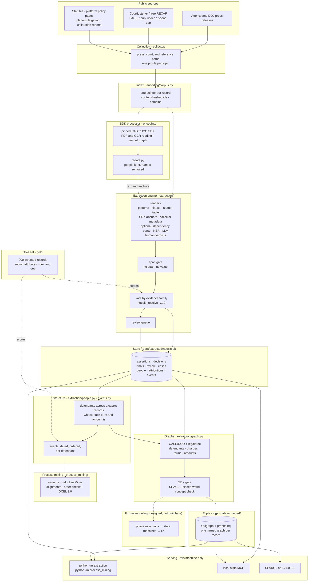
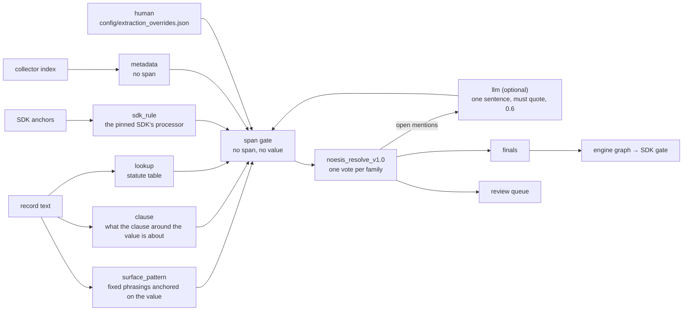

# CaseNoesis Architecture

> **CaseNoesis** reads public enforcement records across offense types, turns each one into span-anchored, vote-resolved structured values and a validated CASE/UCO graph, orders what happened in each case into a dated timeline per defendant, and mines the paths prosecutions take. It is built to model exploitation as state machines. It exists to test one claim: that the Exploitation State Machine from *Affordances for Harm*, derived from child-exploitation cases, describes technology-mediated exploitation in general. The architecture is an instrument built to break its own framework.

| At a glance | |
|---|---|
| Collected | **45,877** distinct public records: 44,602 press releases, 1,207 court filings, 68 reference records. 343 of the court filings narrate an offense: statements of offense, factual bases, and complaint affidavits |
| Domains | Fraud, sex trafficking, forced labor, cyber, child exploitation. Conduct filings also cover extortion, drugs, firearms, corruption, stalking, smuggling, and racketeering |
| Read by the engine | **45,877** records, **3,126,758** span-anchored assertions from 5 reader families. Two more families, a dependency parse and NER, are built and optional |
| Settled | **992,008** values across 16 fields; 372,415 of them by two or more families |
| Left for review | 58,583 mentions the readers contested or could not settle |
| Measured accuracy | On a 200-record gold set of invented records with known attributes, held-out half: F1 of 0.98 to 1.00 on terms, amounts, dates, citations, dockets and defendants; 0.85 to 0.94 on victim counts, scheme and channel labels. Section 13.1 |
| Cases | 45,626 cases; 140 join more than one record |
| People | 60,553 defendants, numbered per case. 208,674 terms, amounts and events placed with a defendant |
| Events | 108,740 events in 44,152 cases, 63,231 with a date |
| Process mining | 64,833 defendant traces, 946 distinct paths; a process tree by the Inductive Miner; 2,390 traces flagged for a departure from procedural order |
| Graphs | 45,898 engine graphs written. 1,620 of them, and 1,232 SDK record graphs, validated against CASE/UCO SDK `v1.33.0`; none failed |
| Triple store | A local Oxigraph store and one N-Quads file: 1,620 named graphs, 249,313 quads, SPARQL from the CLI, MCP, or `127.0.0.1` |
| Where it runs | One machine. Clone, set up, run. No hosted database and no remote service |
| Names in derived data | None stored. People are numbered nodes with a role |
| Conduct | 98,980 acts of offenses read from 32,503 records; 20,314 offense trajectories of two or more acts, at three levels of abstraction |
| Agents | 81 local MCP tools, 23 of them over the engine, its event log and its trajectories |
| Tests | 114 tests on invented text |

Counts were measured on 2026-11-14. Section 5.10 says what was run and what was not.

## Contents

1. [The system in one picture](#1-the-system-in-one-picture)
2. [Design principles](#2-design-principles)
3. [Collection](#3-collection)
4. [The record index](#4-the-record-index)
5. [Extraction: readers, one gate, one vote](#5-extraction-readers-one-gate-one-vote)
6. [Semantic encoding](#6-semantic-encoding)
7. [Cases, people, and events](#7-cases-people-and-events)
8. [Storage](#8-storage)
9. [Formal modeling](#9-formal-modeling)
10. [Analysis: process mining](#10-analysis-process-mining)
11. [Interfaces](#11-interfaces)
12. [Data policy](#12-data-policy)
13. [Verification](#13-verification)
14. [Repository map](#14-repository-map)
15. [What came from CaseLinker](#15-what-came-from-caselinker)
16. [Limitations](#16-limitations)
17. [Not built](#17-not-built)

---

## 1. The system in one picture



**Everything runs on one machine.** Clone the repository, run setup, and the collector, the engine, the stores, and the servers are all local. There is no Postgres, no hosted graph database, and no remote MCP. A Railway deployment exists for demonstrating the site; the corpus and the engine are not on it.

Three stores, all on the research machine, none committed:

| Store | Holds | Read by |
|---|---|---|
| `data/collected/` | What the collector fetched: press rows, court PDFs, reference captures. `public/*_lookup.jsonl` is the committed index: one row per record, no article text | Index, collector, `collector.reproduce` |
| `data/encoded/` | Per record: the SDK's graph, the text it read, its character anchors, a status row, a validation receipt | The engine (text and anchors), `gate_graph` |
| `data/extracted/` | `noesis.db` (assertions, decisions, finals, review queue, cases, people, attributions, events); one engine graph per record with its anchors and receipt; `oxigraph/` and `graphs.nq`, the same graphs as a queryable triple store | CLI, MCP, local SPARQL, the formal layer when it exists |

What is built and what is not:

| Layer | State |
|---|---|
| Collection, three paths | Built |
| Record index | Built |
| SDK record graphs, names removed, validated | Built. All court and reference records; a 300-record press sample |
| Extraction engine: fields, readers, gate, vote, review queue | Built. Run on every collected record |
| Case linking | Built |
| People: defendants linked across a case's records; terms, amounts and events placed with a defendant | Built. Run on every case |
| Events and timelines | Built. Run on every case |
| Process mining: variants, discovered model, conformance, OCEL 2.0 export | Built. Run on every defendant trace |
| Conduct: the acts of an offense, each with its date and the technology named with it | Built, with rule readers. Run on every record. Misses acts told in words outside its vocabulary |
| Offense trajectories at the means, act and phase levels; transition models; divergence between domains; export | Built. Run on every record that narrates two or more acts |
| Gold set: 200 invented records with known attributes, and a scorer | Built. Section 13.1 |
| Dependency-parse and NER readers | Built, off by default. Measured on the gold set; not yet run on the collected corpus |
| Engine graphs through the SDK builder and gate | Built. Written for 45,898 records; 1,620 validated so far (1,228 of 1,229 court records, 68 of 68 reference records, and 324 press records) |
| Local triple store with SPARQL | Built. Holds every validated engine graph |
| MCP tools over the engine | Built |
| Accuracy on real records, against hand labels | **Not done.** The gold set is invented text. It measures the readers on the phrasings its author wrote and does not replace a labelled sample of collected records |
| Phase assertions, state machines, L\*, cross-domain tests | **Not built** for the new domains. Section 9 is the design |

---

## 2. Design principles

- **Public records only.** Press releases, filings already in free RECAP, statutes, archived policy pages. All collection is under UMass HRPO NHSR #8252.
- **No names in derived data.** Source text contains names and stays on the machine. Assertions, decisions, graphs, and tool output do not. A person is `person-1` in the store and `Defendant 1` in a graph. See [5.7](#57-people-and-names).
- **Deterministic first.** Patterns, clause reading, a statute table, and the SDK's rule-based processor are the witnesses. The LLM is optional, off by default, reads one sentence at a time, must quote, and cannot settle a value alone.
- **No span, no value.** Every stored value points at a character span of the record's text, and the value is re-read from the text at that span. A claim with no span can corroborate or contest. It cannot create.
- **A wrong final is worse than review.** When two evidence families disagree, the mention is vetoed and queued. Nothing breaks the tie but a person.
- **Assertions are append-only; decisions are not.** The vote can be redone under a new rule set over the whole corpus without reading one record.
- **The core knows no offense.** Fields and votes are generic. Everything domain-specific is a profile: a vocabulary file. A new offense domain is a new file, not a new pipeline.
- **Standard vocabularies, pinned.** CASE, UCO, and the SDK's legal-process extension, at one SDK commit. A graph that does not pass that commit's shapes and concept check is not a result.
- **Observed is not inferred.** A value read from a record and a quantity estimated from many records are different types in the graph, enforced in SHACL. The engine writes only the first kind.

---

## 3. Collection

`collector/` has three paths. A topic is a profile under `collector/profiles/`, not new code.

| Path | Source | Output |
|---|---|---|
| Press | DOJ News API, agency newsrooms | One JSONL row per release under `data/collected/press_releases/`: body, title, agency, publication date, URL, and a stage the collector reads from the title |
| Court | CourtListener search, filings already in free RECAP. PACER purchase only with `--charge-pacer --max-spend N` | PDFs under `data/collected/recap/<domain>/`, with a manifest row per filing: court, docket number, the press release it was followed from |
| Reference | GovInfo statutes, Wayback snapshots of platform policy pages, platform litigation, calibration reports | Files under `data/collected/hyletic_data/`, each with a provenance sidecar: address and retrieval time |

**Filings that narrate the offense.** A press release announces a prosecution and a judgment records its result. What the defendant did is told in three kinds of filing: a statement of offense or of facts, a factual basis (also called a factual resume or proffer), and a criminal complaint with the agent's affidavit. [`conduct_documents.py`](collector/conduct_documents.py) collects them by searching CourtListener at the document level for docket entries whose own description names the filing, narrowed by full text to an offense domain, and only where RECAP already holds the document. It keeps the filing itself and drops motions and orders that mention one. A civil case files a "statement of facts" too, so the case must be a prosecution: a "United States v." caption or a criminal docket number. Every download is a file from the free archive; the code cannot reach PACER.

One pass, one results page per kind per domain, brought in 411 files, 365 of them distinct. 22 of those came from six civil cases, before the caption check existed; `--exclude-civil` set them aside, leaving 343. Of the 365 as first collected: 109 statements of offense, 146 factual bases and 156 complaint affidavits by docket name, 3,797 pages, across twelve domains. The archive holds far more (about 2,700 for fraud alone); the limit is a search quota of 50 calls an hour. The engine read all 365 and settled a document type for 338. 147 of them state three or more dates for the conduct, which is what a sequence of offense events needs. The engine does not yet read that conduct as events; section 17 lists it.

`data/collected/public/*_lookup.jsonl` is the public index, 46,619 rows, and the only collected data in the repository. `python3 -m collector.reproduce` refetches from it. Hand-off: [`collector/README.md`](collector/README.md).

---

## 4. The record index

[`encoding/corpus.py`](encoding/corpus.py) reads `data/collected/` and writes one pointer per record to `data/encoded/index.jsonl`. It holds locators and public metadata, never text.

| Kind | Id | Identity |
|---|---|---|
| Press | `pr-` + hash of the URL | One record per address |
| Court | `ct-` + hash of the bytes | One record per distinct file |
| Reference | `rf-` + hash of the bytes | One record per distinct file |

- **One file, several domains.** The same filing is often collected for two topics. It is one record, and `domains` lists every folder it was found in, so `--domain fraud` finds it whichever folder sorts first. Of the first 864 court records, 141 are in more than one domain folder or were collected more than once; the 411 conduct filings collected later are 365 distinct files, 343 once filings from civil cases were set aside. A folder whose name starts with `_` is not indexed.
- **The index checks itself.** Press rows are read back by byte offset. `index.meta.json` records each press file's size and modification time and the count of court and reference files; `load_index` rebuilds when any of that has changed, so a collector run cannot leave the engine reading the wrong bytes.
- **46,619 against 45,877.** The lookup has 46,619 rows. After removing repeated addresses and byte-identical files, 45,877 distinct records remain.
- **Where a court filing came from.** Every conduct filing has a public address. Of the 864 court records collected before them, 662 have a public address in the collector's logs. The others were collected before the manifest recorded one; they carry a content hash and no address.

---

## 5. Extraction: readers, one gate, one vote

A value is never stored because one function returned it. Each reader writes its own assertion with a method, a family, a role, a confidence, and a character span. The gate checks the span against the text and re-reads the value there. The resolver counts votes by family and stores only what the evidence supports. Everything else is queued for a person.

Code: [`extraction/`](extraction/).



### 5.1 Fields

[`fields.py`](extraction/fields.py) is the registry. A field is declared once: its roles, the roles that are never stored, and a typed support check. Nothing else in the engine names a field.

Two shapes. In a **mention** field the value is read from the span and the readers vote on its role. In a **tag** field the value is a label from a closed vocabulary, the span is the cue, and the readers vote on each label.

| Field | Shape | Value | Roles |
|---|---|---|---|
| `sentence` | mention | A duration or life | `imposed`, `exposure`, `supervised_release`, `probation`, `custody`, `prior`; `not_sentence` is never stored |
| `money` | mention | Dollars, with the scale word read | `loss`, `intended_loss`, `restitution`, `forfeiture`, `fine`, `exposure_fine`, `proceeds`, `special_assessment`, `bail`, `civil_penalty`; `not_case_amount` is never stored |
| `statute` | mention | A U.S. Code citation, one per section | `cited` |
| `case_number` | mention | A docket number, normalized | `cited` |
| `date` | mention | An ISO date, or a year and month for "in March 2024" | `published`, `filed`, `sentencing`, `offense`, `arrest`, `plea`, `indictment`, `verdict`, `scheduled` |
| `victim_count` | mention | A count | `victims`; `not_victims` is never stored |
| `party` | mention | A person, by number | `defendant`; `official`, `victim` and `not_person` are never stored |
| `event` | mention | The words that report a step: "was sentenced", "pleaded guilty" | `arrest`, `complaint`, `indictment`, `information`, `charge`, `plea`, `verdict`, `conviction`, `sentencing`; `scheduled` and `not_event` are never stored |
| `conduct` | mention | The words that report an act of the offense: "wired", "posed as", "confiscated" | Fifteen kinds of act (section 7.3); `not_conduct` is never stored |
| `attribution` | mention | The span of a term, an amount, an event or an act | The record's person number, or several joined by `+` |
| `stage` | tag | `arrested`, `charged`, `plea`, `convicted`, `sentenced` | `present` |
| `document_type` | tag | `indictment`, `plea_agreement`, `judgment`, … | `present` |
| `offense` | tag | A label from the statute table | `present` |
| `scheme` | tag | A label from the domain profile | `present`; `boilerplate` is never stored |
| `channel` | tag | A label from the common profile | `present`; `boilerplate` is never stored |
| `platform` | tag | A named service | `present`; `boilerplate` is never stored |

A role that is never stored is still a vote. A reader that says "this duration is how long the investigation took" contests a reader that says "this is the sentence", and the mention goes to review.

Two fields carry structure and not a value. An **event** is anchored on the words that report it, and the vote is on what they report: "is scheduled to be sentenced" and "if convicted" are triggers that report nothing, and a reader that says so stops the others. An **attribution** says whose a value is. Its span is the value's span and its role is a person, so two readers that give one term to two different defendants contest each other and the term stays with no one. The gate checks both ends: the span must hold a value of the field it names, and every person span must be a name.

### 5.2 Readers and families

A reader takes a record and returns assertions. It never sees another reader's output and never decides. What the resolver counts is the family.

| Reader | Method | Family | What it reads |
|---|---|---|---|
| [`patterns.py`](extraction/readers/patterns.py) | `regex` | `surface_pattern` | Fixed phrasings that touch the value: "sentenced to", "in restitution", "defrauded … of". Profile cues for tag fields |
| [`clause.py`](extraction/readers/clause.py) | `clause_cue` | `clause` | Every typed token, and which cue is nearest it inside its clause. The sentence logic is CaseLinker's clause classifier |
| [`attribution.py`](extraction/readers/attribution.py) | `clause_subject` | `clause` | Whose a term, an amount or an event is, from the order of the sentence: the nearest person named before it, the people joined with that one, or the person the sentence before was about. Never an official |
| [`syntax.py`](extraction/readers/syntax.py) | `dependency_parse` | `dependency` | Off unless `CASENOESIS_SYNTAX=1`. A Stanza parse: what governs each value, the mood of each trigger, and the grammatical subject or object a value belongs to |
| [`syntax.py`](extraction/readers/syntax.py) | `ner_model` | `ner` | Off unless `CASENOESIS_SYNTAX=1`. Entity types only: a person is named here, or a phrase a name rule matched is an organization or a place |
| [`lookup.py`](extraction/readers/lookup.py) | `statute_table` | `lookup` | A cited section names an offense. A cue-less term equal to that statute's minimum or maximum is exposure |
| [`sdk.py`](extraction/readers/sdk.py) | `sdk_processor` | `sdk_rule` | The pinned SDK's anchors: a statute, an amount, a date, a docket number, a person, a crypto address |
| [`metadata.py`](extraction/readers/metadata.py) | `collector_metadata` | `metadata` | What the collector recorded: stage, bucket, docket number, publication date. No span |
| [`llm.py`](extraction/readers/llm.py) | `llm` | `llm` | Off unless `CASENOESIS_LLM=1`. Only mentions the others left open |
| [`overrides.py`](extraction/readers/overrides.py) | `human` | `human` | Verdicts in `config/extraction_overrides.json` |

Three points about what these families are and are not:

- **`surface_pattern` and `clause` are both rule readers.** They differ in what they anchor on: one needs a known phrasing to touch the value, the other classifies every value from its clause. They agree often and disagree usefully. They are not as independent as a grammar parse and a pattern would be.
- **The SDK names things and does not say what they are for.** On `money` and `date` it abstains on the role. Its vote counts where the question is whether the thing is there: a statute, a docket number, a person, a cryptocurrency address.
- **The parser families are optional.** `dependency` and `ner` come from one Stanza pass (English `default_fast` models) over the sentences that hold something to read, at most 14,000 characters of a record. A parse costs about a thousand times what a pattern costs, so they are off by default, like the LLM, and a run records whether they were on. They answer what word order cannot: "Judge A sentenced B to 87 months" and "B was sentenced by Judge A" parse to the same owner. spaCy is not used; its current release does not run on this Python.
- **On collected text the parser disagrees more than on the gold set.** On a sample of 300 collected press releases, turning the parser families on raised the share of settled `sentence` values backed by two or more families from 84% (463 of 549) to 95% (507 of 531), and of `money` values from 70% (345 of 494) to 84% (394 of 467). It also raised contested mentions: `sentence` from 8 to 42 and `money` from 16 to 82. A contested mention is not stored, so the parser trades some coverage for corroboration. Which side is right in those disagreements has not been examined. The sample took 16 seconds with rules only and 190 seconds with the parser on, single process.
- **An entity type is not a role.** The `ner` family says a span is a person and abstains on who that person is. Its one veto is narrow: a phrase a neutral name rule matched ("Name, 45, of City") that the model types as an organization or a place. It does not overrule a phrasing that itself says who someone is, and it does not judge names printed in capitals, which the model types poorly.

### 5.3 The span gate

[`gate_assertion`](extraction/fields.py) is the one choke point. For a mention field it re-reads a window around the asserted span with the field's own tokenizer, takes the typed token that overlaps the span most, makes that the span, and makes its parsed value the value. The reader's own value is discarded.

This is where the SDK's amount bug stops. The processor anchors `$1.97` in "$1.97 million". The gate widens the span to `$1.97 million` and reads 1,970,000.

The gate rejects a span with no typed token in it, a role the field does not have, and a tag whose cue pattern does not match the text at its span. A rejected assertion is stored with its reason and without its span, and takes no part in the vote. In the run reported below, 786 of 1,930,751 spanned assertions were rejected.

### 5.4 Resolution

[`resolve.py`](extraction/resolve.py), rule set `noesis_resolve_v1.0`, after CaseLinker's `resolve_v3.0`. A mention is a span for a mention field and a label for a tag field.

1. A human verdict wins.
2. `unknown` is an abstention, never a competing role.
3. Votes count by family. Two methods in one family are one vote. A family that asserts two roles for one mention abstains.
4. Two families that disagree veto the mention. It never finalizes.
5. One role from two families is `agreed`. One family at confidence 0.7 or more is `resolved`. Anything weaker is `needs_review`.
6. Settled mentions finalize while other mentions in the same record stay open (`partial`).
7. A witness with no span can corroborate or contest a mention another family found in the text. It never creates a value.
8. A never-stored role is a real vote and is never a value.

Field statuses: `empty`, `agreed`, `resolved`, `partial`, `needs_review`, `disagreement`, `unassigned` (typed tokens were found and no reader gave any of them a role).

`python -m extraction resolve` votes again over stored assertions. It reads no record.

### 5.5 Domain profiles

[`extraction/profiles/`](extraction/profiles/) holds the vocabularies. `common` applies to every record: 25 channels (phone call, e-mail, messaging app, cryptocurrency, gift card, remote access, …) and 42 named platforms. Each offense domain adds its scheme types.

| Profile | Scheme labels | Examples |
|---|---:|---|
| `fraud` | 29 | romance, investment, ponzi, business_email_compromise, tech_support, government_imposter, elder_fraud, pandemic_relief |
| `trafficking` | 10 | sex_trafficking, force_fraud_coercion, debt_bondage, online_advertising |
| `forced_labor` | 11 | domestic_servitude, document_confiscation, visa_fraud, threat_of_deportation |
| `cyber` | 14 | ransomware, intrusion, sim_swapping, darknet_market |
| `csea` | 10 | production, distribution, enticement, sextortion |

A record whose folder has no profile of its own (the mixed `bulk` and `transcripts` court folders) is read against all of them.

A cue inside a sentence that tells the reader where to report or learn more ("call the hotline", "visit ic3.gov") is `boilerplate`. A press release that ends with an e-mail tip line did not involve e-mail.

### 5.6 The statute table

[`statutes.py`](extraction/statutes.py) maps 48 U.S. Code sections to an offense label, the words a record uses for that offense, and, where the base offense has one, a statutory maximum and mandatory minimum in months. The lookup reader turns a citation into the label. The pattern reader turns the offense's name into the same label. When both fire, two families agree on the offense.

The bounds exist to tell "faces 20 years" from "sentenced to 20 years". They are first-offense figures for one count. Where the maximum depends on the subsection, the table holds none and the reader makes no claim.

### 5.7 People and names

A graph without the defendant is not a case graph. A graph with the defendant's name is a problem. The engine keeps the person and drops the name.

- **`party` is a field like any other.** [`names.py`](extraction/names.py) finds name spans from case captions, the "Name, 45, of City" phrasing, honorifics, role words, and prosecution verbs. The readers vote on the role. The SDK's own `Person` anchors corroborate that a person is named there.
- **The value is a number.** After the gate, `pipeline._number_people` numbers the people in a record by first appearance, merging a full name with a later mention that shares the surname. Each assertion's value becomes `person-N` and its stored span text becomes `[name]`. The character offsets still point at the name in the local source text.
- **Officials are votes, not values.** A judge, a prosecutor, or an agent gets the role `official`, which is never stored. It is there so a reader can stop another from calling the U.S. Attorney a defendant.
- **Record text shown to anyone is masked.** A review window from the CLI or an MCP tool passes through `names.scrub` first.
- **An attribution holds offsets, not names.** A reader asserts the character spans of the people a value belongs to. `_number_people` replaces them with the record's person numbers before anything is stored.
- **Graphs are checked.** Before an engine graph is kept, it is searched for every name found in the record's text. A graph that contains one is deleted. That happened for 1 of 45,899 records; its values are in the store and it has no graph.

**Audit.** For 600 records drawn at random, every name the rules find in the record's text was searched for in that record's stored assertions, decisions, review rows, attributions, people rows and events, and in its engine graph. 596 of the records had names. No stored row contained one.

An earlier pass of the same audit found one that did, and it was a fault in the previous version of the engine as well. The SDK anchors a charge on the whole sentence that states it, and the engine stored that sentence, names included, as the assertion's span text. The pipeline now removes names from every span text before it is stored; the offsets still point at the source. After the fix, all 17,668 span texts longer than 25 characters in the 1,186 records with SDK anchors were checked, and none contained a name the rules find.

Name-finding is rule-based and tuned to over-mask. A capitalized phrase it wrongly takes for a name costs a redacted word. For masking, any run of two to four capitalized words inside a sentence is also taken, whole and as written, which catches a name with no label before it. The final check of every graph adds a second detector, Stanza's named-entity model, independent of the rules, so a name they miss is still found. `python -m extraction rescrub` masks stored span text again when the rules change.

### 5.8 The LLM, used narrowly

Off unless `CASENOESIS_LLM=1`. [`llm.py`](extraction/readers/llm.py) reads up to eight sentence windows per record, only for `money` and `sentence` mentions the vote left open. It must answer with a role from the field's own list and an exact quote from the window that contains the mention; anything else is dropped. Its confidence is 0.6, under the 0.7 line, so it can confirm or veto another family and can never store a value by itself. It runs on this machine through Ollama. It was not run for the numbers in this document.

### 5.9 Review and human verdicts

`python -m extraction review --field money --state contested` lists open mentions with the sentence around each, the mention marked and names masked. A person's verdict is a row in `config/extraction_overrides.json`, keyed by record id, with the field, the span, and the role. It passes the same gate and then wins the vote. No tool writes a verdict.

### 5.10 What was run

Measured 2026-11-14, with `python -m extraction status`. Rules only: the parser, NER and LLM readers were off.

| | |
|---|---|
| Records read | 44,602 press, 1,229 court, 68 reference |
| Text source | 1,597 from the SDK's extraction, with anchors; 44,302 press records from the collector's own row, where the `sdk_rule` family has nothing to say |
| Assertions | 3,126,758 |
| Finals | 992,008 |
| Review queue | 58,583: 22,890 contested, 35,693 weak, 0 self-contradicting |

Assertions by family:

| Family | Assertions | With a supported span |
|---|---:|---:|
| `surface_pattern` | 1,608,934 | 1,608,861 |
| `clause` | 1,395,423 | 1,395,201 |
| `metadata` | 72,072 | none by design |
| `sdk_rule` | 44,313 | 43,475 |
| `lookup` | 15,102 | 15,102 |

Settled values by field, and how many were settled by two or more families:

| Field | Settled | By two or more families | Contested | Weak |
|---|---:|---:|---:|---:|
| `sentence` | 80,288 | 68,542 | 1,613 | 0 |
| `money` | 73,216 | 49,514 | 1,685 | 17,229 |
| `statute` | 15,757 | 7,092 | 0 | 0 |
| `case_number` | 2,997 | 1,262 | 0 | 0 |
| `date` | 83,744 | 46,031 | 1,373 | 0 |
| `victim_count` | 5,842 | 4,221 | 1 | 0 |
| `party` | 60,845 | 50,423 | 88 | 0 |
| `event` | 80,881 | 79,053 | 8,579 | 0 |
| `attribution` | 253,814 | 0 | 0 | 18,289 |
| `stage` | 74,299 | 44,031 | 56 | 223 |
| `document_type` | 1,016 | 480 | 0 | 28 |
| `offense` | 87,323 | 4,761 | 0 | 0 |
| `scheme` | 58,501 | 2,371 | 38 | 0 |
| `channel` | 34,326 | 42 | 0 | 0 |
| `platform` | 4,515 | 0 | 0 | 0 |

The review queue is larger than before this work because two fields were added to it: contested `event` triggers, where one reader takes the words for a report of something done and another for something planned or possible, and `attribution` votes below the confidence line, where the owner was carried over from the sentence before.

**These are agreement figures, not accuracy figures.** They say how often the readers settled a mention and how often two of them settled it together. Accuracy is measured separately, on the gold set of section 13.1, where the right answer is known because the records were written from it. Nobody has checked a sample of collected records against their text by hand. Until that is done, a `resolved` value on a real record is one rule reader's reading at confidence 0.7 or more, and should be treated as that.

Reading the gold set found faults that this run no longer has. Each was in how real records are written, and each was confirmed in collected records before it was fixed:

| Fault | Effect before the fix |
|---|---|
| A hyphenated number was read as a range | "twenty-four months" was stored as 4 months, "twenty-five years" as 5 years |
| The judgment form prints counsel's name above "Defendant's Attorney" | The defense attorney was stored as a defendant |
| The form's penalties table has one row of amounts under a row of column names | Every amount in the row took the role of the nearest word, usually `fine` |
| "supervised release for a term of: three years" | The colon broke the phrasing; the term was stored as imprisonment |
| "must notify the United States attorney within 30 days" | A deadline was stored as a one-month sentence |
| A statutory list set off by semicolons | Only the first item was read as exposure; the supervised-release and fine items were stored as imposed |
| "18:1343", the form's citation style | Not read as a citation |
| "in March 2024" | Not a date; most earlier steps in a release are dated this way |
| "is scheduled to be sentenced on" | The date was stored as the sentencing date |
| A caption listing several defendants; "A, B and C are charged" | Only the last name was read as a defendant |
| "aggravated identity theft"; "conspiracy to commit wire fraud" | Each also produced the label of the offense named inside it |
| "mailing address"; "child sexual abuse material" | A `mail` channel; a `hands_on` scheme label |

### 5.11 Extending it

| To add | Do this |
|---|---|
| A field | Write a tokenizer and a `FieldSpec`, call `fields.register` |
| A reader | Write `(Doc) -> [assertion]`, give its method a family in `readers.FAMILY`, call `register_reader` |
| A domain | Add a module under `profiles/` and list it in `_MODULES` |
| A statute | Add a row to `statutes.STATUTES` |
| A verdict | Add a row to `config/extraction_overrides.json` |

---

## 6. Semantic encoding

Two graphs per record, both CASE/UCO, both validated by the same gate.

### 6.1 The SDK record graph

[`encoding/`](encoding/) hands each record to the pinned SDK's `process_document_file`, as shipped: rule-based, no model, with OCR for scanned PDFs. It adds the public address the bytes came from, removes names, and validates. Commands and limits: [`docs/sdk-encoding.md`](docs/sdk-encoding.md).

The processor writes what it reads, so [`redact.py`](encoding/redact.py) runs before validation:

| What the processor wrote | What the graph keeps |
|---|---|
| A `Person` node per name | The node and its relationships, renamed `Person 1`, `Person 2`, … |
| A passage of the record on each event, and the opening of the document on the source node | "Text window withheld." The character span stays in `annotations.jsonld` |
| E-mail addresses | The domain. The local part is replaced |
| A CourtListener address ending in the case caption | The address without the caption slug |
| Any other address whose path spells a name | The host, tagged with the SHA-256 of the full address |
| Names anywhere else in a string | `[name]` |

Then every name found in the record is searched for in the graph and the anchors. Across 1,232 records: 1,032 people renamed, 110 addresses cut, 0 records failing the check.

This graph is the engine's input, not its output. It holds what the SDK's rules found: statutes, amounts, dates, docket numbers, organizations, accounts. It says a person is named and does not say who they are in the case.

### 6.2 The engine graph

[`extraction/graph.py`](extraction/graph.py) writes one graph per record from resolved values only, with the SDK's `CASEGraph` builder.

| Resolved value | Graph object |
|---|---|
| The record | `uco-observable:ObservableObject` with its content hash, tagged with the record id, case id, and every settled label: `stage:sentenced`, `scheme:romance`, `channel:cryptocurrency`, `platform:whatsapp`, `offense:wire_fraud`, `date-filed:2024-03-05` |
| The case | `case-investigation:Investigation` with `legalproc:caseIdentifier` |
| `party` / `defendant` | `uco-identity:Person` named `Defendant 1`, with a `uco-role:Role` |
| `statute` in the table | `legalproc:FederalCharge` with `legalproc:statuteCitation` |
| `sentence` / `imposed`, `supervised_release`, `probation`, `prior` | `legalproc:Sentence` with kind, term, and scope |
| `sentence` / `exposure` | `legalproc:PotentialPenalty`, statutory maximum or mandatory minimum |
| `money` / `restitution`, `forfeiture` | `legalproc:RestitutionOrder`, `legalproc:ForfeitureOrder` with `legalproc:monetaryAmount` |
| `money` / `fine`, `exposure_fine`, `bail` | `legalproc:Sentence` (fine), `legalproc:PotentialPenalty`, `legalproc:PretrialReleaseCondition` |
| `money` / `loss`, `proceeds`, and the rest | `uco-core:Assertion` with the amount. The legal-process vocabulary has no class for a loss |
| `victim_count` | `uco-core:Assertion` with `legalproc:reportedVictimCount` |
| The publishing office or court | `uco-identity:Organization` |
| The run | `case-investigation:InvestigativeAction` naming the engine, rule set, record, and every node produced |

Every node is tagged with how it was settled (`resolution:agreed`, `family:clause`, `family:surface_pattern`). Where each value was read is in `annotations.jsonld` beside the graph: one Web Annotation per node and span, as character positions.

**The graph does not guess who did what.** Each term and amount node is linked to a defendant only where section 7.1 placed it with one: by the attribution vote, or because the record names a single defendant. A value no one was given has no link. Charges are linked to a person (`legalproc:chargedWith`) only in a record with one defendant; with several, which statute each is charged under is not read.

**Events are not in the graph yet.** They are in the store and in the OCEL export. Writing them as CASE/UCO actions is a later step.

**Not in the graph**: phases, transitions, trajectories. See section 9.

### 6.3 The gate and the pins

[`encoding/sdk.py`](encoding/sdk.py) validates a graph with the SDK: SHACL plus the closed-world concept check, with RDFS inference, against the extensions the graph uses. It writes a receipt with the graph's hash and the SDK commit. `conforms` means every stage ran and passed. `publishable` also needs the SDK checkout to be the pinned commit, clean, with no local ontology file.

**This table is the single source of truth for pinned refs** (checked 2026-11-11).

| Surface | Ref | Notes |
|---|---|---|
| CASE/UCO SDK | [vulnmaster/CASE-UCO-SDK](https://github.com/vulnmaster/CASE-UCO-SDK) tag `v1.33.0` → `a2dc8bc96f5001c58af63e587593dbf6385b24cf`, submodule `vendor/CASE-UCO-SDK` | `case-uco` 1.33.0, CASE 1.5.0, UCO 1.5.0. Also written in `encoding/sdk.py`; `python -m encoding pin` fails when the checkout differs |
| Legal-process extension | `extensions/legalproc/`, manifest **0.3.0** | The classes the engine graph uses |
| Trajectories extension | `extensions/trajectories/`, manifest **0.3.1**, status `candidate` | For section 9. Shapes file SHA-256 `9fe3d674de9dba43438805f6a4cdbf81c022c30c7b4b2c37dda624b05388ed80` |
| CAC Ontology | [Project-VIC-International/CAC-Ontology](https://github.com/Project-VIC-International/CAC-Ontology) tag `v3.1.0` → `93de063951b758dd68a27611638c177fcf910eab` | The commit the pinned SDK vendors. Includes ConditioningPhase and the state-machine shapes |
| Validator | `case-utils==0.18.0`, `pyshacl==0.31.0`, `rdflib==7.6.0` | `requirements-encoding.txt` |

---

## 7. Cases, people, and events

A record id names one document. A case is a docket: the release that announced it, the indictment, the plea agreement, the judgment. [`cases.py`](extraction/cases.py) joins records only on a link that cannot be a coincidence.

| Link | Meaning |
|---|---|
| `press_link` | The collector followed this press release to this filing |
| `courtlistener` | Two filings carry the same CourtListener docket id |
| `docket_and_court` | Two filings carry the same docket number in the same court |

A docket number alone is not a link. Federal districts number their cases independently, so `1:23-cr-00123` exists in many courts. Two records that share only a number are written to `case_candidates` for a person to confirm.

Result: 45,626 cases over 45,877 records. 140 join more than one record, the largest joins 14, and 997 candidate pairs wait for confirmation. Most press releases stand alone because no filing was collected for them.

### 7.1 People

Extraction numbers the people of one record. [`people.py`](extraction/people.py) does two things with those numbers.

**It links them across the records of a case.** The same defendant is `person-1` in the release and `person-3` in the judgment; here both become one case person, `p1`. Two record persons are one case person when they share a surname and their given names do not conflict: equal, one absent, or one an initial of the other. The names are read from the local text at the stored spans and compared in memory. No name and no hash of a name is written. A hash would be a stored identifier that a list of names could reverse.

**It settles whose each term, amount and event is.** The `attribution` field holds the readers' votes (section 5.1). Where a record names one defendant, a value no vote placed is that defendant's, because the record cannot be giving it to anyone else; the row says `sole_defendant`. Where a record names several and no vote settled, the value stays with no one. Only roles that belong to a person are placed: an imposed term, supervised release, probation, restitution, forfeiture, a fine, an assessment, and events. A loss and a statutory maximum are the case's.

The engine graph uses this: each term and amount node is linked to the defendant it was placed with.

Measured on the collected corpus, rules only:

| | |
|---|---|
| Defendants | 60,553, in 37,635 records that name at least one |
| Records naming more than one defendant | 12,516 |
| Defendants found in more than one record of their case | 170 |
| Terms placed with a defendant | 24,540 by vote, 10,391 as the sole defendant's |
| Amounts placed with a defendant | 12,427 by vote, 6,135 as the sole defendant's |
| Events placed with a defendant | 59,751 by vote, 35,724 as the sole defendant's |

With the parser off, a vote here is the `clause` family alone. On the gold set that reader placed 97% of what it placed correctly (section 13.1).

In records that name several defendants, 40,465 terms, amounts and event mentions were left with no one: no person is named before the value in its sentence, and the sentence does not open with a pronoun the reader can carry back. This is the largest gap in this layer, and it is the case the parser reader is for.

### 7.2 Events and timelines

A record reports steps: "was indicted in March 2023", "pleaded guilty today", "was sentenced on Sept. 8, 2023". [`events.py`](extraction/events.py) gives each settled `event` a date and a defendant, joins the reports of a case's records, and puts them in order.

A date comes from one of three places, tried in this order:

| Basis | Meaning |
|---|---|
| `stated` | A settled date in the same sentence whose role fits the event |
| `relative` | "today" or "yesterday" beside the trigger, read against the record's publication date |
| `document` | A charging document is itself the charge: its filing date |

An event with none of these is kept with no date. It is known to have happened by the time the record was published, and nothing more.

Two reports are one event when they are the same kind of event, their people do not conflict, and their dates do not conflict. A month contains its days. An undated report joins the one dated event of its kind that the same record reports: a release that says "three people were sentenced today" and then gives each defendant's term is reporting one sentencing. Two sentencings on different dates stay two events. That is a resentencing or an error in a record, and either is worth seeing.

Order is by date. An event with no date is placed by where its kind falls in a prosecution, after the last event that cannot follow it, and `order_basis` records which it was. An analysis that must not assume an order keeps to dated events.

Kinds: `offense` (when the conduct began; one per case, at the earliest date any record gives), `arrest`, `complaint`, `indictment`, `information`, `charge` (charged, instrument not stated), `plea`, `verdict`, `conviction` (convicted, by plea or verdict not stated), `sentencing`.

Measured on the collected corpus:

| Kind | Events | With a date | To the day | To the month |
|---|---:|---:|---:|---:|
| `plea` | 29,559 | 16,954 | 14,053 | 2,901 |
| `sentencing` | 22,660 | 12,795 | 12,020 | 775 |
| `offense` | 19,839 | 19,839 | 3,321 | 16,518 |
| `indictment` | 11,452 | 5,773 | 4,720 | 1,053 |
| `charge` | 8,628 | 468 | 432 | 36 |
| `arrest` | 8,118 | 4,482 | 3,713 | 769 |
| `verdict` | 4,502 | 1,913 | 1,431 | 482 |
| `conviction` | 2,924 | 699 | 545 | 154 |
| `complaint` | 622 | 244 | 228 | 16 |
| `information` | 467 | 71 | 70 | 1 |

108,740 events in 44,152 cases; 63,231 have a date. Of the reports behind them, 42,110 were dated by a stated date, 24,354 by "today" or "yesterday", 620 by a filing date, and 92,913 had no date. 223 events are reported by more than one record.

### 7.3 Conduct: the acts of an offense

Sections 7.1 and 7.2 follow the prosecution. This one follows the offense. A statement of offense, a factual basis, or an agent's affidavit tells what was done as a series of acts, and a press release often tells a shorter version. [`acts.py`](extraction/acts.py) names the kinds of act and [`conduct.py`](extraction/conduct.py) puts each record's acts in order.

| Kind | What it is | Phase |
|---|---|---|
| `setup` | Prepared the means: opened an account, registered a domain or a company | preparation |
| `contact` | Reached a person: messaged, called, approached | approach |
| `recruit` | Drew a person in: recruited, enticed, lured | approach |
| `deception` | Said or submitted something false | leverage |
| `demand` | Asked for or required something of value | leverage |
| `threat` | Threatened harm, exposure, arrest or deportation | leverage |
| `control` | Held a person: took documents, confined, assaulted, coerced | leverage |
| `transfer` | Value passed from the person harmed, who is the payer | harm |
| `access` | Got into a computer or account without authority, or ran code on it | approach |
| `exploit` | Used the person: commercial sex, compelled labor, abuse material | harm |
| `supply` | Sold, shipped or delivered contraband or a weapon, and the buyer's payment for it | harm |
| `transport` | Moved a person or travelled to one | leverage |
| `movement` | The offender moved or changed the value: laundered, withdrew, converted, or wired or deposited it | exit |
| `concealment` | Hid the act afterwards | exit |
| `detection` | What investigators did: an undercover contact, a search | detection |

The kinds are few and are not tied to one offense, so that offenses of different types can be laid side by side. The phase column is the same acts one level up, the stage structure of a crime script (Cornish, 1994).

**How an act is read.** `conduct` is a field like any other. Its span is the words that report the act. Two readers vote on the kind. The pattern reader goes by the verb. The clause reader goes by what the verb acts on, and only for verbs whose kind depends on it: "sent" is a contact when a message follows and a transfer when an amount does. A filing also recites what the statute requires, in the same verbs ("that the defendant recruited, enticed or transported a person"). A trigger inside such a recital is `not_conduct`, a role that is voted and never stored.

**Each act carries its means.** The channel and platform labels whose cue is in the act's own sentence, within its numbered paragraph, are stored with the act. "Contacted the victim on WhatsApp" is a `contact` by `whatsapp`. A record-level label says a platform appears somewhere in a case. This says at which step, which is what a claim about technology and the action space needs.

**Order is the order of telling.** A narrative of facts is told in the order things happened and most of its sentences carry no date. Each act keeps the date its paragraph gives, where it gives one, and `told_in_date_order` reports whether the telling follows the dates.

**General verbs need an object.** "Obtained", "purchased", "created", "opened" and the like name an act only when what follows says what was set up or taken: "opened a bank account" is a `setup`, "obtained $2.9 million" is a `transfer`, "fraudulently obtained proceeds" is a description and no act. Verbs of selling are a `supply` only when what is sold is contraband or a weapon. A row of a statute's verbs ("recruited, enticed, harbored, transported, or obtained") is a recital. These rules came from reading a random sample of acts on collected records after the first corpus pass, which had read "obtained" as a setup 11,425 times.

**Who paid decides a transfer.** A transfer is value from the person harmed, so the payer must be the person harmed: a victim, an investor, a lender, or an institution a fraud takes from (Medicare, an insurer, a bank, a program). The payer is read from the words before the verb in its clause. A buyer paying for contraband is part of the sale (`supply`); the offender paying or depositing is `movement`; a person harmed named only after the verb is who was paid ("paid the victims back"). A random sample of 60 payments on collected records, read by the developer: the direction is right for 43 of the 48 that are payments, where reading by the verb alone was right for about 20. 7 of the 60 are not payments ("had paid", recitals), which this does not address.

**The unit is the record.** Two records of one case tell the same acts in different words, and joining them would mean deciding which sentences describe one act. That is not attempted. A statement of offense tells the whole offense once.

Measured on the collected corpus, rules only:

| | |
|---|---|
| Records with at least one act | 32,503: 31,471 press releases, 1,032 court filings |
| Acts | 98,980; 18,848 settled by both readers |
| Acts with a date | 5,916 |
| Acts with a technology named in their sentence | 13,732 |

| Kind | Acts |
|---|---:|
| `deception` | 21,615 |
| `movement` | 18,196 |
| `recruit` | 9,588 |
| `contact` | 6,046 |
| `setup` | 5,940 |
| `transport` | 5,710 |
| `transfer` | 5,102 |
| `demand` | 5,020 |
| `detection` | 4,800 |
| `concealment` | 4,721 |
| `control` | 4,042 |
| `exploit` | 2,996 |
| `access` | 2,839 |
| `threat` | 1,830 |
| `supply` | 535 |

Before the payer rule, 19,412 acts were read as `transfer` and 5,137 as `movement`. Most of the difference is payments that press releases report by the offender, or with no payer named.

---

## 8. Storage

[`store.py`](extraction/store.py), SQLite at `data/extracted/noesis.db`.

| Table | Holds |
|---|---|
| `runs` | One row per extraction run: reader versions, rule set, SDK commit, code revision, whether the LLM was on |
| `records` | One row per record: text hash, text source, the run that last read it |
| `assertions` | Every reader's claim, append-only: field, value, role, method, family, confidence, span, gate result |
| `resolutions` | One decision per record and field, per rule set |
| `finals` | Settled values, flattened for cohort queries |
| `review_queue` | Mentions the vote left open |
| `cases`, `case_candidates` | Case membership with the basis for each link; unconfirmed pairs |
| `people` | Each defendant of a case, and which numbered person that is in each record |
| `attributions` | Whose each term, amount and event is, per record, with the basis: a vote or the sole defendant |
| `conduct` | The acts each record narrates, in order: kind, date, defendants, and the technology named in the act's sentence |
| `events` | What happened in each case, in order: kind, date, precision, defendants, and the records and spans that report it |
| `graphs` | Per record: graph hash, node count, name check, gate result |

A record whose text hash is unchanged is skipped on the next run. A record read again gets new assertion rows under a new run, and the old rows stay until `python -m extraction prune`.

The store is a single writer. Workers read records and return assertions; the parent writes.

### The triple store

[`triples.py`](extraction/triples.py) loads engine graphs into a local [Oxigraph](https://github.com/oxigraph/oxigraph) store at `data/extracted/oxigraph/`, one named graph per record (`urn:casenoesis:record:<record-id>`), and writes the same quads to `data/extracted/graphs.nq` for any other RDF tool. Both are rebuilt from the graph files at any time; neither is a source of truth.

- **Only validated graphs go in.** A graph is loaded when it passed the SDK gate and the name check. `--include-unvalidated` loads the rest for exploration.
- **Read-only to queries.** `SELECT`, `ASK`, `CONSTRUCT`, and `DESCRIBE` run. An update is refused; the store changes only by loading graphs.
- **The default graph is the union**, so a query across the corpus needs no `GRAPH` clause, and one that wants the record adds `GRAPH ?g`.
- **Three ways in**: `python -m extraction sparql`, the `graph_sparql` MCP tool, and `python -m extraction serve`, which answers the SPARQL protocol on `127.0.0.1:7878` and binds no other address.

```sparql
# Restitution orders of a million dollars or more, with the record each is in
SELECT ?g ?amount WHERE {
  GRAPH ?g { ?o a legalproc:RestitutionOrder ; legalproc:monetaryAmount ?amount .
             FILTER(?amount >= 1000000) }
} ORDER BY DESC(?amount)

# Records where a romance scheme used cryptocurrency
SELECT ?g WHERE { GRAPH ?g { ?r uco-core:tag "scheme:romance", "channel:cryptocurrency" } }
```

Loaded now: 1,620 named graphs, 249,313 quads.

---

## 9. Formal modeling

**Designed. Not built for the new domains.** The engine above produces the observed facts this layer needs. It produces no phase and no transition.

Each case, or typology, is to be instantiated as an exploitation state machine:

$$
M = (S, A, T, R_G, s_0, F)
$$

**State space $S$**: finite offense-phase classes from the ontology spine and domain vocabularies. Backbone invariant $B$:

$$
B = \{\mathrm{InitialContactPhase},\ \mathrm{ConditioningPhase},\ \mathrm{ExploitationPhase},\ \mathrm{MaintenancePhase}\}
$$

Terminal set $F \subseteq S$ holds completed or disrupted terminal phase instances. $s_0 = \mathrm{InitialContactPhase}$ for trajectories that document contact-onset exploitation.

**Transitions**: offender actions between phases. Affordance-enabled transitions carry misuse annotations. Channel migration is a first-class transition-adjacent object when the record supports it.

**Transition function $T$**: empirical edge frequencies over the lifecycle-resolved sample. It is not a population transition law and is not robust to selection effects. Small per-domain $n$ yields weak $T$.

**Objective**: goal-conditioned rewards $R_g(s)$. $L^*_{g,A}$ is the Bellman-optimal path from $s_0$ toward $F$ under affordance environment $A$:

$$
L^{*}_{g,A} = \arg\max_{L \in \mathrm{Seq}(A)} \mathbb{E}\big[U_g(L)\big]
$$

**Affordance annotation**: φ maps a trajectory to an exploitation type, η maps a type to victim-facing harms $H$, ψ maps an affordance class to harms across the trajectories it appears in.

**Intervention counterfactuals**: remove or add friction to a transition or phase and recompute $L^*$ and $V^*(s_0)$. The yield is a ranked set of intervention points, not a deployed control.

Falsifiable targets carried from AfH:

- **Theorem 1 (Closure of $H$)**: the victim-facing harm set is finite and closed
- **Law 1 (Contact Primacy)**: no exploitation trajectory without an initial contact event
- **Law 2 (Backbone Invariance)**: $B$ is present in every complete trajectory
- **Law 3 (Type Invariance)**: a new affordance changes trajectory cost via φ, not exploitation type
- **Law 4 (Affordance Displacement)**: removing an affordance shifts $L^*$ to the nearest bundle; $g$ is unchanged

**How it attaches to the engine.** The SDK's trajectories extension separates what was observed (`traj:PhaseAssertion`) from what was estimated (`traj:StateMachineModel`, `traj:TransitionEstimate`), in SHACL. A phase is one more field: a tag whose labels are a domain's phase scheme, asserted by readers with spans, gated, and voted on like `scheme` is now. A settled phase becomes a `traj:PhaseAssertion` in the engine graph. The pinned SDK already ships a phase scheme for elder fraud (`ef:InitialContact`, `ef:Conditioning`, `ef:ExtractionInstruction`, `ef:ProceedsCollection`, `ef:Laundering`) and for trafficking.

Thirty ICAC lifecycle machines from CaseLinker are in `state_machines/`. They are the framework's origin sample, built by the earlier pipeline, and are not produced by this engine.

---

## 10. Analysis: process mining

The engine extracts and stores. Analysis reads what it stored. One analysis is built: process mining over the events of section 7.2. The tests of the framework in section 9 are not.

### 10.1 Process mining

Code: [`process_mining/`](process_mining/). It answers two questions: what paths do prosecutions take, and how does one case depart from them.

**The log.** A trace is one defendant in one case. A docket is too coarse, because co-defendants are charged together and sentenced apart. An event that names no one belongs to every defendant of its case. The same events are also written as an object-centric event log in the OCEL 2.0 JSON format, with the case, its defendants and its records as separate objects, so that a reader with another tool is not held to this choice of trace.

**Variants.** The distinct sequences of events and how many traces took each.

**A discovered model.** [`discover.py`](process_mining/discover.py) implements the Inductive Miner with infrequent-behaviour filtering (Leemans, Fahland and van der Aalst, 2013 and 2014). It finds a cut in the directly-follows graph (a choice, a sequence, a parallel block, or a loop), splits the log along it, and recurses. The result is a process tree, which is sound by construction. With the noise threshold at zero the tree replays every trace it was mined from. A higher threshold drops orderings that are rare beside what usually follows the same step. The implementation is written for this repository and uses no process-mining library; the common one is licensed AGPL and this repository is MIT.

**Conformance against the model.** [`conform.py`](process_mining/conform.py) aligns each trace with the closest trace the model allows (Adriansyah, van Dongen and van der Aalst, 2011) and counts what is left over: events the model does not allow there, and steps the model expects that the trace lacks. Fitness is one minus that count over the worst case. The closest trace is found by listing what the model allows, with each loop taken at most three extra times, and taking the longest common subsequence. That is exact for models and traces of this size, and it stops with an error when a model allows too much to list.

**Conformance against procedure.** A federal prosecution has an order that does not depend on what cases usually do. Three kinds of departure are reported, over dated events only:

| Kind | Meaning |
|---|---|
| `order` | Two dated events in an order procedure does not allow: a sentencing dated before the plea |
| `repeat` | The same step on two dates: a resentencing, a superseding indictment |
| `plea_and_verdict` | The same defendant both pleaded guilty and was convicted at trial |

A missing step is never counted. The records are incomplete, and a path of "plea, sentencing" means the records mention those two steps. A month is compared as its whole span, so a plea "in March 2024" and a sentencing on March 20 are not out of order. A departure is either something that happened in the case or an error in a record or in the reading of it. The check does not say which. It says where to look.

Measured on the collected corpus, procedural steps only (the `offense` event left out). These figures were taken on 45,899 records, before 22 civil filings were set aside (section 3); the event log has since lost 31 of its 108,771 events.

| | |
|---|---|
| Traces | 64,833 defendants in 43,294 cases |
| Events | 120,654; 60,655 with a date |
| Trace length | 26,684 of one event, 25,559 of two, 12,590 of three or more |
| Traces ordered by dates alone | 23,123 |
| Distinct paths | 946; 457 when only dated events are kept |

Most common paths:

| Path | Traces | Share |
|---|---:|---:|
| plea | 11,502 | 17.7% |
| plea → sentencing | 11,226 | 17.3% |
| sentencing | 5,610 | 8.7% |
| indictment | 3,964 | 6.1% |
| charge | 2,214 | 3.4% |
| indictment → charge | 1,581 | 2.4% |
| arrest | 1,548 | 2.4% |
| indictment → plea | 1,525 | 2.4% |

The model mined at noise 0.2 replays the log with fitness 0.943; 85.7% of traces fit it exactly. It allows 84 paths, with loops bounded, of which 75 were observed.

```text
sequence
  one of
    (skip)
    sequence
      one of
        sequence
          one of
            (skip)
            complaint
          one of
            (skip)
            arrest
          one of
            (skip)
            indictment
        information
      one of
        (skip)
        charge
    sequence
      one of
        (skip)
        conviction
      one of
        (skip)
        verdict
  one of
    (skip)
    plea
  one of
    (skip)
    sentencing
```

Days between consecutive steps, where both are dated to the day:

| From | To | Traces | Timed | Median days |
|---|---|---:|---:|---:|
| plea | sentencing | 17,324 | 3,905 | 145 |
| indictment | plea | 4,047 | 782 | 135 |
| indictment | charge | 3,432 | 83 | 0 |
| charge | plea | 3,385 | 58 | 129 |
| arrest | indictment | 2,957 | 733 | 0 |
| verdict | sentencing | 2,617 | 338 | 151 |
| arrest | charge | 2,291 | 80 | 0 |
| arrest | plea | 2,257 | 423 | 287 |

Departures from procedural order: 2,390 traces in 1,967 cases. 850 `order`, 917 `repeat`, 954 `plea_and_verdict`. None of these has been reviewed by a person; each is a place where either the case or the reading of it is unusual.

**What this describes.** Prosecuted conduct, as the offices that prosecuted it chose to report it. A sentencing release is written to announce a sentence and mentions earlier steps in passing, so short paths are common and are a fact about releases. The model is a description of how these records report prosecutions. It is not a model of offending, and section 16 says why.

### 10.2 Offense trajectories

[`trajectory.py`](process_mining/trajectory.py) builds one trajectory per record from the acts of section 7.3 and reads it at three levels:

| Level | A step is | Example |
|---|---|---|
| `means` | The act and the technology its sentence names | `contact[whatsapp]` |
| `act` | The act alone | `contact` |
| `phase` | The stage of the offense | `approach` |

The levels exist because the research question is about levels. Setting them beside one another does not test it: a coarser level of any data diverges less, even above its shuffled baseline, because it is a grouping of the finer one. Section 9 tests the question against nulls that can fail it.

| View | What it gives |
|---|---|
| Paths | The distinct paths at a level, and the process tree the Inductive Miner finds for them |
| Transitions | From each step, how often each step follows, with counts, and the entropy of what follows. The observed side of a Markov model |
| Means by act | Which channel or platform is named at which act, per domain |
| Compare | How far apart the offense domains are at each level |
| Export | Every trajectory as a plain row: acts with kind, phase, date and means, and the path at each level. No text and no name |

**Compare, and how to read it.** For each pair of domains with enough trajectories, the Jensen-Shannon divergence between their distributions of steps, and of transitions, is computed at each level. A coarser level has fewer categories, and fewer categories alone lower a divergence, so every figure is reported beside the same figure with the domain labels shuffled. What a level shows is the gap above the shuffled figure.

Measured on the collected corpus:

| Records | Trajectories of two or more acts | Median steps | With four or more steps |
|---|---:|---:|---:|
| Court filings | 867 | 4 | 498 |
| Press releases | 19,447 | 2 | 4,188 |

Most common paths at the phase level, court filings:

| Path | Trajectories | Share |
|---|---:|---:|
| leverage → exit | 51 | 5.9% |
| leverage | 44 | 5.1% |
| approach → leverage | 41 | 4.7% |
| exit | 30 | 3.5% |
| approach | 21 | 2.4% |
| leverage → approach | 20 | 2.3% |

Most common paths at the phase level, press releases:

| Path | Trajectories | Share |
|---|---:|---:|
| leverage | 2,451 | 12.6% |
| leverage → exit | 1,483 | 7.6% |
| exit | 1,228 | 6.3% |
| approach → leverage | 1,122 | 5.8% |
| exit → leverage | 909 | 4.7% |
| approach → exit | 610 | 3.1% |

Harm is rarer than before the payer rule: many payments are now read as the offender moving money, and a release that tells only how proceeds were moved has no harm step.

Divergence between offense domains, all records (bulk 272, csea 115, cyber 95, forced_labor 156, fraud 17,795, smuggling 26, stalking 25, trafficking 1,720 trajectories):

| Level | Categories | Steps: observed | shuffled | above shuffled | Transitions: observed | shuffled | above shuffled |
|---|---:|---:|---:|---:|---:|---:|---:|
| `phase` | 5 | 0.067 | 0.009 | 0.058 | 0.191 | 0.054 | 0.136 |
| `act` | 14 | 0.242 | 0.040 | 0.202 | 0.495 | 0.210 | 0.285 |
| `means` | 909 | 0.326 | 0.130 | 0.196 | 0.597 | 0.356 | 0.241 |

Divergences are in bits, from 0 (identical) to 1 (nothing shared), averaged over pairs of domains.

**What this is not.** It is not a test of the framework. The figures come from rule readers that miss acts told in words outside their vocabulary, the domain of a filing is the search term it was collected under, and the corpus is prosecuted conduct as prosecutors narrate it. The comparison is the instrument a test would use. A test needs the readers checked on real filings, domains assigned by charge and not by search term, and a model that predicts what the divergences should be.

### 10.3 Not built

**The primary outputs are tests of the apparatus.** None is computed yet for the new domains.

- Cross-domain invariant testing: Theorem 1 and Laws 1–4
- Phase-transition frequency and timing
- Affordance co-occurrence across trajectories and domains
- Intervention points under counterfactual transition or phase removal

What the engine also supports today, through the CLI and MCP: cohorts by settled value (`scheme = romance` and `channel = cryptocurrency`; `money / loss ≥ $1M`; `sentence / imposed ≥ 120 months`), label counts per domain, and reader agreement per field. These are corpus descriptions over rule-reader output. They are inputs to the tests above, not results.

ICAC-tuned severity triage from CaseLinker is in the repository and is not part of CaseNoesis's outputs. Its weights are domain semantics and do not transfer.

---

## 11. Interfaces

**Command line.** `python -m encoding` (index, SDK processor, redaction, gate), `python -m extraction`, `python -m process_mining`, and `python -m gold`:

```bash
python -m extraction run --kind press --workers 6    # read records: readers, gate, vote
python -m extraction resolve                         # vote again over stored assertions
python -m extraction cases                           # group records into cases
python -m extraction people                          # link defendants across records; settle whose each value is
python -m extraction events                          # date and order what happened in each case
python -m extraction timeline <case-id | record-id>
python -m extraction graph --gate --workers 6        # write and validate engine graphs
python -m extraction store                           # load validated graphs into Oxigraph and graphs.nq
python -m extraction sparql "SELECT ..."              # query the triple store
python -m extraction serve                           # SPARQL over HTTP on 127.0.0.1
python -m extraction status
python -m extraction show <record-id>
python -m extraction review --field money --state contested
python -m extraction search money --role loss --min 1000000 --domain fraud
python -m extraction count scheme --domain fraud
python -m extraction case <case-id | record-id>
python -m extraction fields

python -m process_mining log                         # the event log: traces, events, how many are dated
python -m process_mining variants --limit 15         # the paths cases take
python -m process_mining model --noise 0.2           # the discovered model and how well the log fits it
python -m process_mining conform                     # departures from procedural order
python -m process_mining case <case-id | record-id>
python -m process_mining ocel data/extracted/events.ocel.json

python -m extraction conduct                         # put the acts each record narrates in order
python -m process_mining conduct summary
python -m process_mining conduct paths --level phase --kind court
python -m process_mining conduct transitions --domain fraud
python -m process_mining conduct compare             # how far apart the domains are at each level
python -m process_mining conduct means --domain fraud
python -m process_mining conduct record <record-id>
python -m process_mining conduct export data/extracted/trajectories.jsonl

python -m gold build                                 # write the gold corpus from its generator
python -m gold score --split test                    # run the engine on it and score every layer
python -m gold conduct score --split test            # the acts read from the gold statements of offense
CASENOESIS_SYNTAX=1 python -m gold score --split test   # with the parser and NER readers on
```

`python -m extraction run --syntax` turns the parser and NER readers on for a run.

**MCP.** [`casenoesis_mcp/`](casenoesis_mcp/) is a local stdio server. There is no hosted MCP. 23 tools are over the engine, its event log and its trajectories:

| Tool | Kind | Answers |
|---|---|---|
| `extraction_status` | READ | Records read, assertions by family, decisions by field, review queue, cases, graphs |
| `extraction_fields` | READ | Every field, its roles, its labels; the readers and their families |
| `extraction_record` | READ | One record: settled values, the families behind each, open mentions with masked windows |
| `extraction_review_queue` | READ | Open mentions by field and state |
| `extraction_search` | READ | A cohort by field, role, label, domain, or numeric range |
| `extraction_count` | READ | How many records settled each label or role |
| `extraction_case` | READ | A case: its records, the basis for each link, candidate links |
| `extraction_agreement` | READ | Reader agreement per field. Says in its own description that it is not accuracy |
| `case_timeline` | READ | One case: its defendants, its events in order with how each date was read, and whose each term and amount is |
| `process_log` | READ | The event log: traces, events by kind, how many are dated |
| `process_variants` | READ | The paths cases take, with each one's share |
| `process_model` | READ | The discovered process tree, how well the log replays on it, and the days between steps |
| `process_conformance` | READ | Traces that depart from procedural order, by kind |
| `process_case` | READ | One case against the model and against procedure |
| `conduct_summary` | READ | The acts read from records, by kind |
| `conduct_record` | READ | One record's acts in order, with the path at each level |
| `conduct_paths` | READ | The paths offenses take at the means, act or phase level, and the model mined from them |
| `conduct_transitions` | READ | From each step, how often each step follows, with entropy |
| `conduct_compare` | READ | Divergence between offense domains at each level, against a shuffled baseline |
| `conduct_means` | READ | Which technology is named at which act, per domain |
| `graph_sparql` | READ | SPARQL over the local triple store. Updates refused |
| `graph_store_status` | READ | Named graphs, quads, where the store is, example queries |
| `extraction_run` | WRITE, local | Read records, link cases, optionally build and validate graphs and load them into the triple store |

Every READ tool answers from stored assertions and decisions. None calls a model and none writes a value. An agent explores; it does not extract. Three more tools cover the SDK path: `encoding_status`, `gate_graph`, `encoding_process_records`. Full catalog: [`casenoesis_mcp/tool_registry.md`](casenoesis_mcp/tool_registry.md).

**Local SPARQL.** `python -m extraction serve` is a read-only SPARQL endpoint on `127.0.0.1`. `/` returns the engine and store status with example queries.

**FastAPI.** `python3 run/main.py` serves the researcher site and the corpus tools carried over from CaseLinker, on localhost. It reads the older ICAC case database, not the engine's store.

---

## 12. Data policy

| | |
|---|---|
| Collected | Public enforcement and court records, and public reference documents. NHSR #8252 |
| Kept on the machine | Source text, PDFs, SDK graphs, the assertion store, engine graphs, the triple store. `data/collected/` (except the lookup), `data/encoded/`, and `data/extracted/` are gitignored |
| Services | All local: a stdio MCP server, a SPARQL endpoint bound to `127.0.0.1`, a localhost site. Nothing listens on a public address |
| Committed | Code, profiles, the statute table, and `data/collected/public/*_lookup.jsonl`: one row per record with its address, no text |
| Names | In source text only. Not in an assertion, a decision, a graph, or tool output. Section 5.7 |
| Victims | A count when the record states one. No node per victim, and a named victim is a never-stored role |
| What leaves through MCP | Counts, cohorts of record ids, settled values, SPARQL results over name-free graphs, and sentence windows with names masked |
| PACER | Never purchased without `--charge-pacer --max-spend N`. The engine reads what is on disk and fetches nothing |
| Models | None by default. The optional LLM is local; no record text leaves the machine |

A sealed label on a docket entry that reached free RECAP is a label from before unsealing. The record is public and the label stays.

---

## 13. Verification

```bash
export DYLD_LIBRARY_PATH=/opt/homebrew/opt/expat/lib       # macOS, for the validator
.venv/bin/python -m unittest encoding.test_encoding extraction.test_extraction extraction.test_structure process_mining.test_process process_mining.test_trajectory gold.test_gold collector.test_conduct_documents
.venv/bin/python -m encoding pin        # exits non-zero when the SDK is not the pin
.venv/bin/python -m encoding status
.venv/bin/python -m extraction status
```

114 tests, all on invented text; no collected record is read.

| Covered | By |
|---|---|
| Typed tokens: scale words, citation forms and lists, adjacent terms, docket and date normalization | `TypedTokenTests` |
| The gate: value from text, no span no value, role not in field | `GateTests` |
| Every resolution rule, one test each | `VoteTests` |
| Readers on a synthetic release: roles, two-family agreement, boilerplate, SDK anchors | `ReaderTests` |
| No name in any assertion or decision; masking; SDK graph redaction, and that a second pass changes nothing | `NameTests` |
| The LLM gate: quote must contain the mention; cannot finalize alone | `LlmTests` |
| Store, skip-if-read, re-vote, case linking, masked review windows, engine graph validates and holds defendants and no names, triple store answers SPARQL and refuses updates | `StoreAndGraphTests` |
| The SDK pin, the gate on a valid and an invalid fixture, record encoding | `encoding.test_encoding` |
| Month dates, hyphenated numbers, the judgment form (terms, the penalties table, dates, counsel, checkboxes), statutory lists, event moods, attribution with two defendants, the sole-defendant rule, one defendant across a release and a judgment, event merging and ordering | `extraction.test_structure` |
| The Inductive Miner on the papers' running example, a loop, a skipped step, replay with no noise filter, noise filtering, alignments, every procedural check | `process_mining.test_process` |
| Acts in order from a narrative; a recital of the statute is not conduct; ambiguous verbs decided by their object; three levels of one trajectory; transition frequencies and entropy; domains that differ only in means are alike above that level | `process_mining.test_trajectory` |
| How a docket entry is classified; only the free archive is ever downloaded from | `collector.test_conduct_documents` |
| The committed gold corpus is what the generator writes; every typed token in it is claimed or listed; development-split scores stay above their floors | `gold.test_gold` |

What the tests do not show: that the readers are right on real records. That needs a hand-labelled sample of collected records, which does not exist.

### 13.1 The gold set

Labelling collected records by hand was not possible here, and a model's labels are not ground truth. The gold set takes the other route: write the records from the answers.

[`gold/`](gold/) holds 200 invented records in 133 cases. [`world.py`](gold/world.py) draws each case from a seeded generator: its defendants, charges, dates, terms and amounts, and the path it took. [`render.py`](gold/render.py) writes documents from the case in six shapes modeled on the structure of real records and written from scratch: releases announcing charges, a plea or verdict, and a sentence; a charging document; a plea agreement; and a judgment on form AO 245B. Beside the text it records what the text states: every amount, term, date, citation and count with its role and whose it is, every label, every event. The people, dockets and amounts are invented. Districts, agencies and statutes are real, because a record naming a fictional court would not have the shape of a real one. Sources are under `gold.example`.

What makes it a test and not a demonstration:

- **Distractors.** Statutory maximums, the length of a trial, an installment amount, a deadline, a hotline paragraph, officials named beside defendants. A typed token the truth does not claim must be left alone, and a build-time check confirms that every typed token in every record is either claimed or listed as a distractor.
- **Paraphrase.** Some narratives describe a scheme without its usual name. A reader that needs the name misses them, and the score shows it.
- **Planted departures.** Some cases are resentenced, some withdraw a plea and go to trial, and some documents state a plea date after the sentencing date.
- **Two splits.** Cases alternate between `dev` and `test`. The readers were corrected against `dev` only. `test` was scored once, after the last change.
- **Arguable labels are not scored.** Where a label is defensible either way, as when a record names the offense "bank fraud" and `bank_fraud` is also a scheme label, it neither earns nor costs.

Held-out `test` split, 100 records. "Before this work" is the engine as of the previous pull request, scored on the same records.

| Field | Before this work, F1 | Now: precision | recall | F1 | With parser and NER, F1 |
|---|---:|---:|---:|---:|---:|
| `sentence` | 0.898 | 1.000 | 0.984 | 0.992 | 1.000 |
| `money` | 0.821 | 1.000 | 0.954 | 0.976 | 0.976 |
| `date` | 0.466 | 1.000 | 0.993 | 0.997 | 1.000 |
| `statute` | 0.928 | 1.000 | 1.000 | 1.000 | 1.000 |
| `case_number` | 1.000 | 1.000 | 1.000 | 1.000 | 1.000 |
| `victim_count` | 0.727 | 1.000 | 0.743 | 0.852 | 0.852 |
| `party` | 0.813 | 1.000 | 0.985 | 0.992 | 1.000 |
| `stage` | 0.984 | 0.976 | 0.992 | 0.984 | 0.984 |
| `document_type` | 1.000 | 1.000 | 1.000 | 1.000 | 1.000 |
| `offense` | 0.914 | 1.000 | 1.000 | 1.000 | 1.000 |
| `scheme` | 0.854 | 0.946 | 0.815 | 0.876 | 0.876 |
| `channel` | 0.884 | 1.000 | 0.890 | 0.942 | 0.942 |
| `platform` | 1.000 | 1.000 | 1.000 | 1.000 | 1.000 |

`date` was low before because a month and a year was not a date and a scheduled date had no role of its own.

Structure and process mining, on the same split:

| Measure | Rules only | With parser and NER |
|---|---:|---:|
| Events, exact kind, date and defendant: precision / recall | 0.933 / 0.967 | 0.949 / 0.976 |
| Events, kind folded to charge or disposition, date to the month: F1 | 0.956 | 0.972 |
| Attribution: right, of the terms and amounts given to someone | 0.972 | 1.000 |
| Attribution: share given to someone | 0.927 | 0.948 |
| Attribution in records with several defendants: right / wrong / given to no one | 54 / 5 / 11 | 60 / 0 / 10 |
| Same defendant linked across a case's records: F1 | 1.000 | 1.000 |
| Records linked into the right case: F1 | 1.000 | 1.000 |
| A defendant's whole sequence of events, exactly right | 75 of 88 | 75 of 88 |
| Departures from procedure, per defendant: precision / recall | 0.600 / 0.600 | 0.833 / 1.000 |
| Cases with a planted departure that their records state, flagged | 5 of 5 | 5 of 5 |
| True traces replayed on the model mined from extracted traces: fitness | 1.000 | 1.000 |

Reports are committed under [`gold/results/`](gold/results/).

**Conduct.** [`gold/conduct.py`](gold/conduct.py) adds 80 invented statements of offense, each written from a script of acts with known kinds, dates and means, across nine kinds of offense. Each script is told two ways: one in the verbs a reader would expect, one paraphrased, sometimes in words the readers' vocabulary does not hold. The documents also recite the elements of the offense in the statute's verbs, which must not be read as acts.

| Measure, held-out split (40 statements) | Precision | Recall | F1 |
|---|---:|---:|---:|
| An act and its kind, in order | 1.000 | 0.715 | 0.834 |
| The act with its date | 0.989 | 0.707 | 0.824 |
| The act with the technology named in its sentence | 0.994 | 0.711 | 0.829 |

| Whole path exactly right | Held-out | Development |
|---|---:|---:|
| Plain tellings | 17 of 22 | 18 of 18 |
| Paraphrased tellings | 1 of 18 | 1 of 22 |
| Path at the phase level, all tellings | 20 of 40 | 19 of 40 |

The readers are precise and incomplete. A plain telling is read whole. A paraphrased one almost never is: "parted with $42,000" is a transfer and "ran ransomware on the servers" is an access, and neither phrase is in the vocabulary. The vocabulary was not extended with the paraphrases, because both splits share them and that would be fitting the test. This is the measured limit of reading conduct by a list of verbs, and it is the case for a reader that understands a sentence it has not seen: the parser family, or the quoting LLM witness of section 5.8.

**What these numbers are and are not.** They are exact counts against known truth, reproducible from the seed. They are not accuracy on collected records. The documents were written by the author of the readers, from the same understanding of how such records are phrased, and `dev` and `test` come from the same generator, so `test` measures generalization across cases and wordings the generator can produce and not across wordings it cannot. A real record phrased in a way neither the readers nor the templates anticipated is missed by both. The gold set shows that the engine does what it is designed to do on well-formed records of the kinds it was built for, catches regressions, and found the faults listed in section 5.10. A labelled sample of collected records is still the missing measurement.

---

## 14. Repository map

| Path | What it is |
|---|---|
| [`collector/`](collector/) | Collection: press, court, reference. Profiles under `collector/profiles/` |
| [`encoding/`](encoding/) | Record index, SDK processor, name redaction, SDK pin and gate |
| [`extraction/`](extraction/) | **The engine.** `fields.py`, `spans.py`, `resolve.py`, `readers/`, `profiles/`, `statutes.py`, `names.py`, `pipeline.py`, `store.py`, `cases.py`, `people.py`, `events.py`, `acts.py`, `conduct.py`, `source.py`, `graph.py`, `triples.py`, `explore.py` |
| [`process_mining/`](process_mining/) | Process mining over the engine's events: `log.py` (traces, OCEL 2.0), `discover.py` (variants, Inductive Miner), `conform.py` (alignments, procedural order), `trajectory.py` (offense trajectories, transitions, comparison, export), `views.py` |
| [`gold/`](gold/) | The gold set: `world.py` (invented cases), `render.py` (documents and their truth), `build.py`, `score.py`, `corpus/` (the 200 records), `results/` |
| [`casenoesis_mcp/`](casenoesis_mcp/) | Local stdio MCP server |
| `vendor/CASE-UCO-SDK` | The pinned SDK, a submodule |
| [`docs/sdk-encoding.md`](docs/sdk-encoding.md) | The SDK path in detail |
| `config/extraction_overrides.json` | Human verdicts. Optional; absent until a person writes one |
| `src/`, `ontology/`, `state_machines/`, `visualization/`, `run/`, `models/`, `scripts/` | **CaseLinker-era code for ICAC**, carried in when this repository was started from CaseLinker. `src/` is an earlier version of CaseLinker's extraction, before its assertion layer. `ontology/features_to_cac.py` is its CAC mapper. The engine does not import any of it |

---

## 15. What came from CaseLinker

CaseLinker is the public ICAC system: a collector, a corpus, a query API. CaseNoesis is the cross-domain instrument. They share a design and little code.

| From CaseLinker | In CaseNoesis |
|---|---|
| Every reader writes its own assertion with a span | Kept |
| One span gate; the value is read from the text | Kept, and made per-field through a registry instead of one function with a branch per field |
| Votes by evidence family; disagreement vetoes; review queue; append-only assertions; versioned re-resolution | Kept. `noesis_resolve_v1.0` is `resolve_v3.0` without the age-specific rules, plus the span-less witness rule and never-stored roles |
| Sentence clause classifier, number and duration parsing, sentence and clause boundaries | Ported unchanged into `spans.py` |
| Statute lookup for exposure | Kept; the table grew from 9 child-exploitation sections to 48 across domains, and now also names the offense |
| LLM as a quoting, sub-threshold witness | Kept |
| Age fields and their gate; CyberTip fields; ICAC severity | Not ported. They belong to a CSEA profile's field set, which is not written |
| spaCy token and dependency readers, Stanza NER | Rewritten on Stanza alone as two optional families, `dependency` and `ner`. They also vote on events and on whose a value is, which CaseLinker's did not |
| CAC mapper (`features_to_cac.py`) | Replaced for the new domains by `extraction/graph.py` on the SDK's legal-process extension |
| No direct identifiers in derived data | Kept, and extended to the SDK's record graphs |

New in CaseNoesis: the field registry, tag fields, domain profiles, the SDK as a reader, collector metadata as a span-less witness, people as numbered parties, case linking across press and court records, graph write-back through the pinned SDK with a receipt per graph, a triple store that is a local file rather than a hosted service, events and attributions as voted fields, defendants linked across a case's records, dated timelines, process mining, and a gold set built from known answers.

---

## 16. Limitations

- **No accuracy figure on collected records.** The gold set measures the readers on invented records written by their author. Agreement between rule readers on real records is not correctness. Two readers that share a vocabulary can agree and be wrong together.
- **The readers are rules.** They read phrasings they know. A loss described in a way no pattern covers is an amount with no role, and stays out of the finals.
- **`resolved` is one reader.** A value settled by a single family is that family's reading. `status=agreed` in a search keeps only values two families settled.
- **Press and court text read differently.** The phrasings were written with press releases and charging documents in mind. Transcripts and docket sheets get typed tokens and few roles.
- **Whose sentence.** Terms, amounts and events are placed with a defendant by sentence order, and by grammar when the parser is on. Charges are not: with several defendants, which statute each is charged under is not read. A value given to a pronoun two sentences from its name is left with no one.
- **People across records.** Defendants are linked within a case by surname and compatible given name. Two co-defendants who share both would be merged. People are not linked across cases.
- **Press releases of one prosecution are not joined to each other.** A charging release and a sentencing release are one case only when a collected filing links them. Most timelines therefore come from one record and are short.
- **Dates.** "Today" is read against the publication date, which is the release's date and can be a day after the event. An event with no date is ordered by its kind, which is an assumption, and is marked as one.
- **The process model describes records.** It is mined from what prosecuted, announced cases report. A step no record mentions is absent from the trace, and the common paths are short for that reason.
- **Conduct is read from a list of verbs.** It is precise and it misses an act told in other words: on the gold statements, about seven in ten acts are found and a paraphrased telling is almost never read whole. Short trajectories on real records are partly this.
- **A trajectory is one record's telling.** Acts are not joined across the records of a case, and an undated act is placed by where it is told.
- **Means are by sentence.** A technology named in the sentence before the act is not attached to it.
- **Domain is the collector's.** A filing is in the domain whose search terms it matched, and the comparison between domains inherits that.
- **The parser has not been run on the corpus.** Its effect is measured on the gold set only. It reads at most 14,000 characters of a record.
- **Name-finding is rule-based, checked by a model.** It over-masks by design and can still miss a name written in a form no rule covers, such as a single unlabeled name. The final check runs Stanza's named-entity model over every graph's free text, independent of the rules; where Stanza is not installed, that check reports `not_run`. The engine graph holds no text from the record.
- **The SDK path is partial for press.** Only a 300-record sample has an SDK graph. For the rest the engine reads the collector's text and the `sdk_rule` family is silent.
- **HTML reference pages.** The SDK's HTML reader keeps script and style text and extracts no entities. Archived policy pages are hashed and recorded, and read poorly.
- **Prosecutorial artifacts.** A charging document says what was charged, not everything that happened. A press release says what an office chose to announce.
- **Selection.** The corpus is detected, prosecuted, publicly disclosed conduct.
- **Platform attribution.** Many records name no platform. Affordance analysis is limited to those that do.
- **The SDK processor is imported from `mcp_server/`.** That is not a published API, and a new tag can move it.

---

## 17. Not built

In the order they unblock the science:

1. **A reader for conduct that is not a word list.** The dependency family, or the quoting LLM witness, voting on acts beside the two rule readers, so that a paraphrased act is found. The gold statements measure the gap it has to close.
1. **The Exploitation State Machine and its decision model.** The trajectories, transition frequencies and means of section 10.2 are what such a model is fitted to and tested against. States, an action space, and a goal are not defined here.
1. **A labelled sample of collected records.** A few hundred, each field checked against the text by a person, stratified by domain and record kind. The gold set shows the engine works on records of known shape; this shows how far real records depart from that shape.
2. **Joining the press releases of one prosecution.** Same office, same defendants, compatible dates. It needs a rule strict enough not to merge two people with one name, and it would turn one-record timelines into full ones.
3. **Phase fields.** One tag field per domain phase scheme, with readers, so a settled phase becomes a `traj:PhaseAssertion`.
4. **State machines and L\*** for fraud, trafficking, and forced labor, and the cross-domain tests of section 9.
5. **Charges per defendant**, and coreference beyond the previous sentence.
6. **The parser families on the whole corpus**, and a comparison of what they change.
7. **A CSEA field set.** Ages and their gate, ported from CaseLinker into a profile.
8. **Validating every press graph.** The engine graph is written for every record read. Validation takes about three seconds a graph, so the press corpus is several hours of gate time; `python -m extraction graph --kind press --gate --workers 6` does it, and `store` then loads them. SDK record graphs for the full press corpus are a separate 1.8 GB.
9. **Removing the CaseLinker-era code**, or moving it behind an ICAC profile, once nothing local depends on it.
