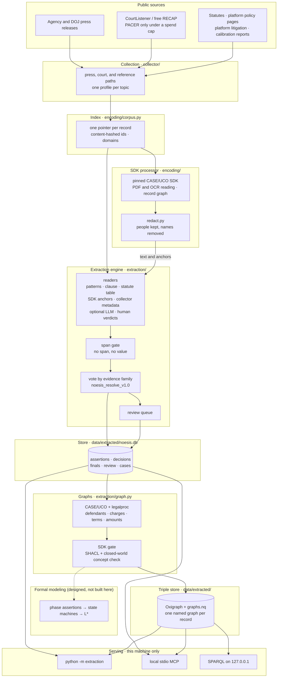
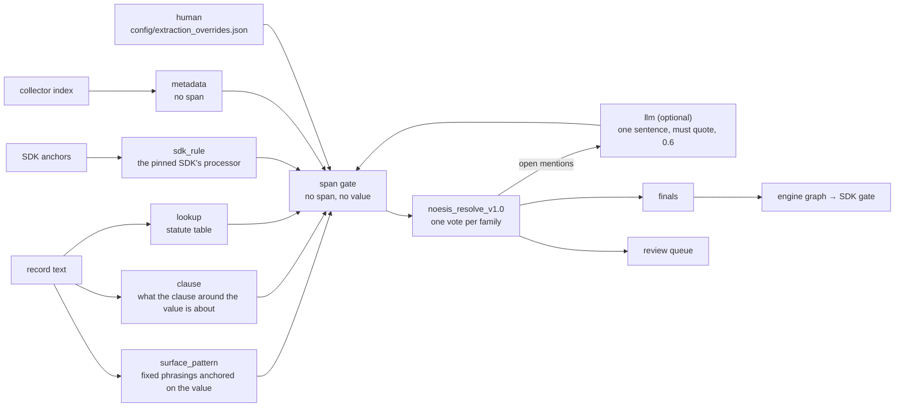

# CaseNoesis Architecture

> **CaseNoesis** reads public enforcement records across offense types, turns each one into span-anchored, vote-resolved structured values and a validated CASE/UCO graph, and is built to model exploitation as state machines. It exists to test one claim: that the Exploitation State Machine from *Affordances for Harm*, derived from child-exploitation cases, describes technology-mediated exploitation in general. The architecture is an instrument built to break its own framework.

| At a glance | |
|---|---|
| Collected | **45,534** distinct public records: 44,602 press releases, 864 court filings, 68 reference records |
| Domains | Fraud, sex trafficking, forced labor, cyber, child exploitation |
| Read by the engine | **45,530** records, **2,000,663** span-anchored assertions from 5 reader families |
| Settled | **533,803** values across 13 fields; 246,953 of them by two or more families |
| Left for review | 21,124 mentions the readers contested or could not settle |
| Cases | 45,316 cases; 116 join more than one record |
| Graphs | 908 SDK record graphs and 24 engine graphs, each validated against CASE/UCO SDK `v1.33.0` |
| Triple store | A local Oxigraph store and one N-Quads file: 24 named graphs, 2,427 quads, SPARQL from the CLI, MCP, or `127.0.0.1` |
| Where it runs | One machine. Clone, set up, run. No hosted database and no remote service |
| Names in derived data | None stored. People are numbered nodes with a role |
| Agents | 68 local MCP tools, 11 of them over the engine |
| Tests | 41 tests on invented text |

Counts were measured on 2026-11-13. Section 5.10 says what was run and what was not.

## Contents

1. [The system in one picture](#1-the-system-in-one-picture)
2. [Design principles](#2-design-principles)
3. [Collection](#3-collection)
4. [The record index](#4-the-record-index)
5. [Extraction: readers, one gate, one vote](#5-extraction-readers-one-gate-one-vote)
6. [Semantic encoding](#6-semantic-encoding)
7. [Cases](#7-cases)
8. [Storage](#8-storage)
9. [Formal modeling](#9-formal-modeling)
10. [Analysis](#10-analysis)
11. [Interfaces](#11-interfaces)
12. [Data policy](#12-data-policy)
13. [Verification](#13-verification)
14. [Repository map](#14-repository-map)
15. [What came from CaseLinker](#15-what-came-from-caselinker)
16. [Limitations](#16-limitations)
17. [Not built](#17-not-built)

---

## 1. The system in one picture



**Everything runs on one machine.** Clone the repository, run setup, and the collector, the engine, the stores, and the servers are all local. There is no Postgres, no hosted graph database, and no remote MCP. A Railway deployment exists for demonstrating the site; the corpus and the engine are not on it.

Three stores, all on the research machine, none committed:

| Store | Holds | Read by |
|---|---|---|
| `data/collected/` | What the collector fetched: press rows, court PDFs, reference captures. `public/*_lookup.jsonl` is the committed index: one row per record, no article text | Index, collector, `collector.reproduce` |
| `data/encoded/` | Per record: the SDK's graph, the text it read, its character anchors, a status row, a validation receipt | The engine (text and anchors), `gate_graph` |
| `data/extracted/` | `noesis.db` (assertions, decisions, finals, review queue, cases); one engine graph per record with its anchors and receipt; `oxigraph/` and `graphs.nq`, the same graphs as a queryable triple store | CLI, MCP, local SPARQL, the formal layer when it exists |

What is built and what is not:

| Layer | State |
|---|---|
| Collection, three paths | Built |
| Record index | Built |
| SDK record graphs, names removed, validated | Built. All court and reference records; a 300-record press sample |
| Extraction engine: fields, readers, gate, vote, review queue | Built. Run on every collected record |
| Case linking | Built |
| Engine graphs through the SDK builder and gate | Built. Written and validated for 24 records |
| Local triple store with SPARQL | Built. Holds every validated engine graph |
| MCP tools over the engine | Built |
| Accuracy measured against hand labels | **Not done.** No labelled sample exists yet |
| Dependency-parse and NER readers | **Not built.** No parser models are on this machine |
| Phase assertions, state machines, L\*, cross-domain tests | **Not built** for the new domains. Section 9 is the design |

---

## 2. Design principles

- **Public records only.** Press releases, filings already in free RECAP, statutes, archived policy pages. All collection is under UMass HRPO NHSR #8252.
- **No names in derived data.** Source text contains names and stays on the machine. Assertions, decisions, graphs, and tool output do not. A person is `person-1` in the store and `Defendant 1` in a graph. See [5.7](#57-people-and-names).
- **Deterministic first.** Patterns, clause reading, a statute table, and the SDK's rule-based processor are the witnesses. The LLM is optional, off by default, reads one sentence at a time, must quote, and cannot settle a value alone.
- **No span, no value.** Every stored value points at a character span of the record's text, and the value is re-read from the text at that span. A claim with no span can corroborate or contest. It cannot create.
- **A wrong final is worse than review.** When two evidence families disagree, the mention is vetoed and queued. Nothing breaks the tie but a person.
- **Assertions are append-only; decisions are not.** The vote can be redone under a new rule set over the whole corpus without reading one record.
- **The core knows no offense.** Fields and votes are generic. Everything domain-specific is a profile: a vocabulary file. A new offense domain is a new file, not a new pipeline.
- **Standard vocabularies, pinned.** CASE, UCO, and the SDK's legal-process extension, at one SDK commit. A graph that does not pass that commit's shapes and concept check is not a result.
- **Observed is not inferred.** A value read from a record and a quantity estimated from many records are different types in the graph, enforced in SHACL. The engine writes only the first kind.

---

## 3. Collection

`collector/` has three paths. A topic is a profile under `collector/profiles/`, not new code.

| Path | Source | Output |
|---|---|---|
| Press | DOJ News API, agency newsrooms | One JSONL row per release under `data/collected/press_releases/`: body, title, agency, publication date, URL, and a stage the collector reads from the title |
| Court | CourtListener search, filings already in free RECAP. PACER purchase only with `--charge-pacer --max-spend N` | PDFs under `data/collected/recap/<domain>/`, with a manifest row per filing: court, docket number, the press release it was followed from |
| Reference | GovInfo statutes, Wayback snapshots of platform policy pages, platform litigation, calibration reports | Files under `data/collected/hyletic_data/`, each with a provenance sidecar: address and retrieval time |

`data/collected/public/*_lookup.jsonl` is the public index, 46,230 rows, and the only collected data in the repository. `python3 -m collector.reproduce` refetches from it. Hand-off: [`collector/README.md`](collector/README.md).

---

## 4. The record index

[`encoding/corpus.py`](encoding/corpus.py) reads `data/collected/` and writes one pointer per record to `data/encoded/index.jsonl`. It holds locators and public metadata, never text.

| Kind | Id | Identity |
|---|---|---|
| Press | `pr-` + hash of the URL | One record per address |
| Court | `ct-` + hash of the bytes | One record per distinct file |
| Reference | `rf-` + hash of the bytes | One record per distinct file |

- **One file, several domains.** The same filing is often collected for two topics. It is one record, and `domains` lists every folder it was found in, so `--domain fraud` finds it whichever folder sorts first. 141 of the 864 court records are in more than one domain folder or were collected more than once.
- **The index checks itself.** Press rows are read back by byte offset. `index.meta.json` records each press file's size and modification time and the count of court and reference files; `load_index` rebuilds when any of that has changed, so a collector run cannot leave the engine reading the wrong bytes.
- **46,230 against 45,534.** The lookup has 46,230 rows. After removing repeated addresses and byte-identical files, 45,534 distinct records remain.
- **Where a court filing came from.** 662 of 864 court records have a public address in the collector's logs. The others were collected before the manifest recorded one; they carry a content hash and no address.

---

## 5. Extraction: readers, one gate, one vote

A value is never stored because one function returned it. Each reader writes its own assertion with a method, a family, a role, a confidence, and a character span. The gate checks the span against the text and re-reads the value there. The resolver counts votes by family and stores only what the evidence supports. Everything else is queued for a person.

Code: [`extraction/`](extraction/).



### 5.1 Fields

[`fields.py`](extraction/fields.py) is the registry. A field is declared once: its roles, the roles that are never stored, and a typed support check. Nothing else in the engine names a field.

Two shapes. In a **mention** field the value is read from the span and the readers vote on its role. In a **tag** field the value is a label from a closed vocabulary, the span is the cue, and the readers vote on each label.

| Field | Shape | Value | Roles |
|---|---|---|---|
| `sentence` | mention | A duration or life | `imposed`, `exposure`, `supervised_release`, `probation`, `custody`, `prior`; `not_sentence` is never stored |
| `money` | mention | Dollars, with the scale word read | `loss`, `intended_loss`, `restitution`, `forfeiture`, `fine`, `exposure_fine`, `proceeds`, `special_assessment`, `bail`, `civil_penalty`; `not_case_amount` is never stored |
| `statute` | mention | A U.S. Code citation, one per section | `cited` |
| `case_number` | mention | A docket number, normalized | `cited` |
| `date` | mention | An ISO date | `published`, `filed`, `sentencing`, `offense`, `arrest`, `plea`, `indictment`, `verdict` |
| `victim_count` | mention | A count | `victims`; `not_victims` is never stored |
| `party` | mention | A person, by number | `defendant`; `official` and `victim` are never stored |
| `stage` | tag | `arrested`, `charged`, `plea`, `convicted`, `sentenced` | `present` |
| `document_type` | tag | `indictment`, `plea_agreement`, `judgment`, … | `present` |
| `offense` | tag | A label from the statute table | `present` |
| `scheme` | tag | A label from the domain profile | `present`; `boilerplate` is never stored |
| `channel` | tag | A label from the common profile | `present`; `boilerplate` is never stored |
| `platform` | tag | A named service | `present`; `boilerplate` is never stored |

A role that is never stored is still a vote. A reader that says "this duration is how long the investigation took" contests a reader that says "this is the sentence", and the mention goes to review.

### 5.2 Readers and families

A reader takes a record and returns assertions. It never sees another reader's output and never decides. What the resolver counts is the family.

| Reader | Method | Family | What it reads |
|---|---|---|---|
| [`patterns.py`](extraction/readers/patterns.py) | `regex` | `surface_pattern` | Fixed phrasings that touch the value: "sentenced to", "in restitution", "defrauded … of". Profile cues for tag fields |
| [`clause.py`](extraction/readers/clause.py) | `clause_cue` | `clause` | Every typed token, and which cue is nearest it inside its clause. The sentence logic is CaseLinker's clause classifier |
| [`lookup.py`](extraction/readers/lookup.py) | `statute_table` | `lookup` | A cited section names an offense. A cue-less term equal to that statute's minimum or maximum is exposure |
| [`sdk.py`](extraction/readers/sdk.py) | `sdk_processor` | `sdk_rule` | The pinned SDK's anchors: a statute, an amount, a date, a docket number, a person, a crypto address |
| [`metadata.py`](extraction/readers/metadata.py) | `collector_metadata` | `metadata` | What the collector recorded: stage, bucket, docket number, publication date. No span |
| [`llm.py`](extraction/readers/llm.py) | `llm` | `llm` | Off unless `CASENOESIS_LLM=1`. Only mentions the others left open |
| [`overrides.py`](extraction/readers/overrides.py) | `human` | `human` | Verdicts in `config/extraction_overrides.json` |

Three points about what these families are and are not:

- **`surface_pattern` and `clause` are both rule readers.** They differ in what they anchor on: one needs a known phrasing to touch the value, the other classifies every value from its clause. They agree often and disagree usefully. They are not as independent as a grammar parse and a pattern would be.
- **The SDK names things and does not say what they are for.** On `money` and `date` it abstains on the role. Its vote counts where the question is whether the thing is there: a statute, a docket number, a person, a cryptocurrency address.
- **CaseLinker's dependency and NER readers are not here.** They need spaCy and Stanza models, and neither is installed. The `clause` reader is the grammar-free stand-in. A parser-backed reader would register under a `dependency` family beside it.

### 5.3 The span gate

[`gate_assertion`](extraction/fields.py) is the one choke point. For a mention field it re-reads a window around the asserted span with the field's own tokenizer, takes the typed token that overlaps the span most, makes that the span, and makes its parsed value the value. The reader's own value is discarded.

This is where the SDK's amount bug stops. The processor anchors `$1.97` in "$1.97 million". The gate widens the span to `$1.97 million` and reads 1,970,000.

The gate rejects a span with no typed token in it, a role the field does not have, and a tag whose cue pattern does not match the text at its span. A rejected assertion is stored with its reason and without its span, and takes no part in the vote. In the run reported below, 592 of 1,929,321 spanned assertions were rejected.

### 5.4 Resolution

[`resolve.py`](extraction/resolve.py), rule set `noesis_resolve_v1.0`, after CaseLinker's `resolve_v3.0`. A mention is a span for a mention field and a label for a tag field.

1. A human verdict wins.
2. `unknown` is an abstention, never a competing role.
3. Votes count by family. Two methods in one family are one vote. A family that asserts two roles for one mention abstains.
4. Two families that disagree veto the mention. It never finalizes.
5. One role from two families is `agreed`. One family at confidence 0.7 or more is `resolved`. Anything weaker is `needs_review`.
6. Settled mentions finalize while other mentions in the same record stay open (`partial`).
7. A witness with no span can corroborate or contest a mention another family found in the text. It never creates a value.
8. A never-stored role is a real vote and is never a value.

Field statuses: `empty`, `agreed`, `resolved`, `partial`, `needs_review`, `disagreement`, `unassigned` (typed tokens were found and no reader gave any of them a role).

`python -m extraction resolve` votes again over stored assertions. It reads no record.

### 5.5 Domain profiles

[`extraction/profiles/`](extraction/profiles/) holds the vocabularies. `common` applies to every record: 25 channels (phone call, e-mail, messaging app, cryptocurrency, gift card, remote access, …) and 42 named platforms. Each offense domain adds its scheme types.

| Profile | Scheme labels | Examples |
|---|---:|---|
| `fraud` | 29 | romance, investment, ponzi, business_email_compromise, tech_support, government_imposter, elder_fraud, pandemic_relief |
| `trafficking` | 10 | sex_trafficking, force_fraud_coercion, debt_bondage, online_advertising |
| `forced_labor` | 11 | domestic_servitude, document_confiscation, visa_fraud, threat_of_deportation |
| `cyber` | 14 | ransomware, intrusion, sim_swapping, darknet_market |
| `csea` | 10 | production, distribution, enticement, sextortion |

A record whose folder has no profile of its own (the mixed `bulk` and `transcripts` court folders) is read against all of them.

A cue inside a sentence that tells the reader where to report or learn more ("call the hotline", "visit ic3.gov") is `boilerplate`. A press release that ends with an e-mail tip line did not involve e-mail.

### 5.6 The statute table

[`statutes.py`](extraction/statutes.py) maps 48 U.S. Code sections to an offense label, the words a record uses for that offense, and, where the base offense has one, a statutory maximum and mandatory minimum in months. The lookup reader turns a citation into the label. The pattern reader turns the offense's name into the same label. When both fire, two families agree on the offense.

The bounds exist to tell "faces 20 years" from "sentenced to 20 years". They are first-offense figures for one count. Where the maximum depends on the subsection, the table holds none and the reader makes no claim.

### 5.7 People and names

A graph without the defendant is not a case graph. A graph with the defendant's name is a problem. The engine keeps the person and drops the name.

- **`party` is a field like any other.** [`names.py`](extraction/names.py) finds name spans from case captions, the "Name, 45, of City" phrasing, honorifics, role words, and prosecution verbs. The readers vote on the role. The SDK's own `Person` anchors corroborate that a person is named there.
- **The value is a number.** After the gate, `pipeline._number_people` numbers the people in a record by first appearance, merging a full name with a later mention that shares the surname. Each assertion's value becomes `person-N` and its stored span text becomes `[name]`. The character offsets still point at the name in the local source text.
- **Officials are votes, not values.** A judge, a prosecutor, or an agent gets the role `official`, which is never stored. It is there so a reader can stop another from calling the U.S. Attorney a defendant.
- **Record text shown to anyone is masked.** A review window from the CLI or an MCP tool passes through `names.scrub` first.
- **Graphs are checked.** Before an engine graph is kept, it is searched for every name found in the record's text. A graph that contains one is deleted.

Name-finding is rule-based and tuned to over-mask. A capitalized phrase it wrongly takes for a name costs a redacted word. A name no rule recognizes can survive in the SDK's record graph; it cannot enter the engine graph, which has no free text.

### 5.8 The LLM, used narrowly

Off unless `CASENOESIS_LLM=1`. [`llm.py`](extraction/readers/llm.py) reads up to eight sentence windows per record, only for `money` and `sentence` mentions the vote left open. It must answer with a role from the field's own list and an exact quote from the window that contains the mention; anything else is dropped. Its confidence is 0.6, under the 0.7 line, so it can confirm or veto another family and can never store a value by itself. It runs on this machine through Ollama. It was not run for the numbers in this document.

### 5.9 Review and human verdicts

`python -m extraction review --field money --state contested` lists open mentions with the sentence around each, the mention marked and names masked. A person's verdict is a row in `config/extraction_overrides.json`, keyed by record id, with the field, the span, and the role. It passes the same gate and then wins the vote. No tool writes a verdict.

### 5.10 What was run

Measured 2026-11-13, with `python -m extraction status`.

| | |
|---|---|
| Records read | 44,602 press, 860 court, 68 reference |
| Text source | 1,228 from the SDK's extraction, with anchors; 44,302 press records from the collector's own row, where the `sdk_rule` family has nothing to say |
| Assertions | 2,000,663 |
| Finals | 533,803 |
| Review queue | 21,124: 3,662 contested, 17,462 weak, 0 self-contradicting |

Assertions by family:

| Family | Assertions | With a supported span |
|---|---:|---:|
| `surface_pattern` | 1,186,151 | 1,186,082 |
| `clause` | 692,059 | 692,059 |
| `lookup` | 14,252 | 14,252 |
| `sdk_rule` | 36,859 | 36,336 |
| `metadata` | 71,342 | none by design |

Settled values by field, and how many were settled by two or more families:

| Field | Settled | By two or more families | Contested | Weak |
|---|---:|---:|---:|---:|
| `sentence` | 80,165 | 68,369 | 1,676 | 0 |
| `money` | 72,204 | 49,080 | 1,661 | 17,275 |
| `statute` | 14,581 | 6,234 | 0 | 0 |
| `case_number` | 2,615 | 916 | 0 | 0 |
| `date` | 38,794 | 21,637 | 156 | 0 |
| `victim_count` | 5,690 | 4,197 | 1 | 0 |
| `party` | 53,788 | 45,322 | 74 | 0 |
| `stage` | 73,918 | 43,923 | 56 | 162 |
| `document_type` | 668 | 193 | 0 | 25 |
| `offense` | 95,440 | 4,676 | 0 | 0 |
| `scheme` | 58,070 | 2,371 | 38 | 0 |
| `channel` | 33,689 | 35 | 0 | 0 |
| `platform` | 4,181 | 0 | 0 | 0 |

**These are agreement figures, not accuracy figures.** They say how often the readers settled a mention and how often two of them settled it together. Nobody has checked a sample of finals against the text by hand. Until that is done, a `resolved` value is one rule reader's reading at confidence 0.7 or more, and should be treated as that.

### 5.11 Extending it

| To add | Do this |
|---|---|
| A field | Write a tokenizer and a `FieldSpec`, call `fields.register` |
| A reader | Write `(Doc) -> [assertion]`, give its method a family in `readers.FAMILY`, call `register_reader` |
| A domain | Add a module under `profiles/` and list it in `_MODULES` |
| A statute | Add a row to `statutes.STATUTES` |
| A verdict | Add a row to `config/extraction_overrides.json` |

---

## 6. Semantic encoding

Two graphs per record, both CASE/UCO, both validated by the same gate.

### 6.1 The SDK record graph

[`encoding/`](encoding/) hands each record to the pinned SDK's `process_document_file`, as shipped: rule-based, no model, with OCR for scanned PDFs. It adds the public address the bytes came from, removes names, and validates. Commands and limits: [`docs/sdk-encoding.md`](docs/sdk-encoding.md).

The processor writes what it reads, so [`redact.py`](encoding/redact.py) runs before validation:

| What the processor wrote | What the graph keeps |
|---|---|
| A `Person` node per name | The node and its relationships, renamed `Person 1`, `Person 2`, … |
| A passage of the record on each event, and the opening of the document on the source node | "Text window withheld." The character span stays in `annotations.jsonld` |
| E-mail addresses | The domain. The local part is replaced |
| A CourtListener address ending in the case caption | The address without the caption slug |
| Any other address whose path spells a name | The host, tagged with the SHA-256 of the full address |
| Names anywhere else in a string | `[name]` |

Then every name found in the record is searched for in the graph and the anchors. Across 908 records: 697 people renamed, 110 addresses cut, 0 records failing the check.

This graph is the engine's input, not its output. It holds what the SDK's rules found: statutes, amounts, dates, docket numbers, organizations, accounts. It says a person is named and does not say who they are in the case.

### 6.2 The engine graph

[`extraction/graph.py`](extraction/graph.py) writes one graph per record from resolved values only, with the SDK's `CASEGraph` builder.

| Resolved value | Graph object |
|---|---|
| The record | `uco-observable:ObservableObject` with its content hash, tagged with the record id, case id, and every settled label: `stage:sentenced`, `scheme:romance`, `channel:cryptocurrency`, `platform:whatsapp`, `offense:wire_fraud`, `date-filed:2024-03-05` |
| The case | `case-investigation:Investigation` with `legalproc:caseIdentifier` |
| `party` / `defendant` | `uco-identity:Person` named `Defendant 1`, with a `uco-role:Role` |
| `statute` in the table | `legalproc:FederalCharge` with `legalproc:statuteCitation` |
| `sentence` / `imposed`, `supervised_release`, `probation`, `prior` | `legalproc:Sentence` with kind, term, and scope |
| `sentence` / `exposure` | `legalproc:PotentialPenalty`, statutory maximum or mandatory minimum |
| `money` / `restitution`, `forfeiture` | `legalproc:RestitutionOrder`, `legalproc:ForfeitureOrder` with `legalproc:monetaryAmount` |
| `money` / `fine`, `exposure_fine`, `bail` | `legalproc:Sentence` (fine), `legalproc:PotentialPenalty`, `legalproc:PretrialReleaseCondition` |
| `money` / `loss`, `proceeds`, and the rest | `uco-core:Assertion` with the amount. The legal-process vocabulary has no class for a loss |
| `victim_count` | `uco-core:Assertion` with `legalproc:reportedVictimCount` |
| The publishing office or court | `uco-identity:Organization` |
| The run | `case-investigation:InvestigativeAction` naming the engine, rule set, record, and every node produced |

Every node is tagged with how it was settled (`resolution:agreed`, `family:clause`, `family:surface_pattern`). Where each value was read is in `annotations.jsonld` beside the graph: one Web Annotation per node and span, as character positions.

**The graph does not guess who did what.** A record with one defendant links that person to its charges (`legalproc:chargedWith`) and its terms. A record with several defendants does not: the readers settle that there are three people and four terms, and nothing yet settles which term is whose.

**Not in the graph**: phases, transitions, trajectories. See section 9.

### 6.3 The gate and the pins

[`encoding/sdk.py`](encoding/sdk.py) validates a graph with the SDK: SHACL plus the closed-world concept check, with RDFS inference, against the extensions the graph uses. It writes a receipt with the graph's hash and the SDK commit. `conforms` means every stage ran and passed. `publishable` also needs the SDK checkout to be the pinned commit, clean, with no local ontology file.

**This table is the single source of truth for pinned refs** (checked 2026-11-11).

| Surface | Ref | Notes |
|---|---|---|
| CASE/UCO SDK | [vulnmaster/CASE-UCO-SDK](https://github.com/vulnmaster/CASE-UCO-SDK) tag `v1.33.0` → `a2dc8bc96f5001c58af63e587593dbf6385b24cf`, submodule `vendor/CASE-UCO-SDK` | `case-uco` 1.33.0, CASE 1.5.0, UCO 1.5.0. Also written in `encoding/sdk.py`; `python -m encoding pin` fails when the checkout differs |
| Legal-process extension | `extensions/legalproc/`, manifest **0.3.0** | The classes the engine graph uses |
| Trajectories extension | `extensions/trajectories/`, manifest **0.3.1**, status `candidate` | For section 9. Shapes file SHA-256 `9fe3d674de9dba43438805f6a4cdbf81c022c30c7b4b2c37dda624b05388ed80` |
| CAC Ontology | [Project-VIC-International/CAC-Ontology](https://github.com/Project-VIC-International/CAC-Ontology) tag `v3.1.0` → `93de063951b758dd68a27611638c177fcf910eab` | The commit the pinned SDK vendors. Includes ConditioningPhase and the state-machine shapes |
| Validator | `case-utils==0.18.0`, `pyshacl==0.31.0`, `rdflib==7.6.0` | `requirements-encoding.txt` |

---

## 7. Cases

A record id names one document. A case is a docket: the release that announced it, the indictment, the plea agreement, the judgment. [`cases.py`](extraction/cases.py) joins records only on a link that cannot be a coincidence.

| Link | Meaning |
|---|---|
| `press_link` | The collector followed this press release to this filing |
| `courtlistener` | Two filings carry the same CourtListener docket id |
| `docket_and_court` | Two filings carry the same docket number in the same court |

A docket number alone is not a link. Federal districts number their cases independently, so `1:23-cr-00123` exists in many courts. Two records that share only a number are written to `case_candidates` for a person to confirm.

Result: 45,316 cases over 45,530 records. 116 join more than one record, the largest joins 14, and 948 candidate pairs wait for confirmation. Most press releases stand alone because no filing was collected for them.

Defendants are numbered within a record. `Defendant 1` in the release and `Defendant 1` in the indictment are not yet known to be the same person.

---

## 8. Storage

[`store.py`](extraction/store.py), SQLite at `data/extracted/noesis.db`.

| Table | Holds |
|---|---|
| `runs` | One row per extraction run: reader versions, rule set, SDK commit, code revision, whether the LLM was on |
| `records` | One row per record: text hash, text source, the run that last read it |
| `assertions` | Every reader's claim, append-only: field, value, role, method, family, confidence, span, gate result |
| `resolutions` | One decision per record and field, per rule set |
| `finals` | Settled values, flattened for cohort queries |
| `review_queue` | Mentions the vote left open |
| `cases`, `case_candidates` | Case membership with the basis for each link; unconfirmed pairs |
| `graphs` | Per record: graph hash, node count, name check, gate result |

A record whose text hash is unchanged is skipped on the next run. A record read again gets new assertion rows under a new run, and the old rows stay until `python -m extraction prune`.

The store is a single writer. Workers read records and return assertions; the parent writes.

### The triple store

[`triples.py`](extraction/triples.py) loads engine graphs into a local [Oxigraph](https://github.com/oxigraph/oxigraph) store at `data/extracted/oxigraph/`, one named graph per record (`urn:casenoesis:record:<record-id>`), and writes the same quads to `data/extracted/graphs.nq` for any other RDF tool. Both are rebuilt from the graph files at any time; neither is a source of truth.

- **Only validated graphs go in.** A graph is loaded when it passed the SDK gate and the name check. `--include-unvalidated` loads the rest for exploration.
- **Read-only to queries.** `SELECT`, `ASK`, `CONSTRUCT`, and `DESCRIBE` run. An update is refused; the store changes only by loading graphs.
- **The default graph is the union**, so a query across the corpus needs no `GRAPH` clause, and one that wants the record adds `GRAPH ?g`.
- **Three ways in**: `python -m extraction sparql`, the `graph_sparql` MCP tool, and `python -m extraction serve`, which answers the SPARQL protocol on `127.0.0.1:7878` and binds no other address.

```sparql
# Restitution orders of a million dollars or more, with the record each is in
SELECT ?g ?amount WHERE {
  GRAPH ?g { ?o a legalproc:RestitutionOrder ; legalproc:monetaryAmount ?amount .
             FILTER(?amount >= 1000000) }
} ORDER BY DESC(?amount)

# Records where a romance scheme used cryptocurrency
SELECT ?g WHERE { GRAPH ?g { ?r uco-core:tag "scheme:romance", "channel:cryptocurrency" } }
```

Loaded now: 24 named graphs, 2,427 quads.

---

## 9. Formal modeling

**Designed. Not built for the new domains.** The engine above produces the observed facts this layer needs. It produces no phase and no transition.

Each case, or typology, is to be instantiated as an exploitation state machine:

$$
M = (S, A, T, R_G, s_0, F)
$$

**State space $S$**: finite offense-phase classes from the ontology spine and domain vocabularies. Backbone invariant $B$:

$$
B = \{\mathrm{InitialContactPhase},\ \mathrm{ConditioningPhase},\ \mathrm{ExploitationPhase},\ \mathrm{MaintenancePhase}\}
$$

Terminal set $F \subseteq S$ holds completed or disrupted terminal phase instances. $s_0 = \mathrm{InitialContactPhase}$ for trajectories that document contact-onset exploitation.

**Transitions**: offender actions between phases. Affordance-enabled transitions carry misuse annotations. Channel migration is a first-class transition-adjacent object when the record supports it.

**Transition function $T$**: empirical edge frequencies over the lifecycle-resolved sample. It is not a population transition law and is not robust to selection effects. Small per-domain $n$ yields weak $T$.

**Objective**: goal-conditioned rewards $R_g(s)$. $L^*_{g,A}$ is the Bellman-optimal path from $s_0$ toward $F$ under affordance environment $A$:

$$
L^{*}_{g,A} = \arg\max_{L \in \mathrm{Seq}(A)} \mathbb{E}\big[U_g(L)\big]
$$

**Affordance annotation**: φ maps a trajectory to an exploitation type, η maps a type to victim-facing harms $H$, ψ maps an affordance class to harms across the trajectories it appears in.

**Intervention counterfactuals**: remove or add friction to a transition or phase and recompute $L^*$ and $V^*(s_0)$. The yield is a ranked set of intervention points, not a deployed control.

Falsifiable targets carried from AfH:

- **Theorem 1 (Closure of $H$)**: the victim-facing harm set is finite and closed
- **Law 1 (Contact Primacy)**: no exploitation trajectory without an initial contact event
- **Law 2 (Backbone Invariance)**: $B$ is present in every complete trajectory
- **Law 3 (Type Invariance)**: a new affordance changes trajectory cost via φ, not exploitation type
- **Law 4 (Affordance Displacement)**: removing an affordance shifts $L^*$ to the nearest bundle; $g$ is unchanged

**How it attaches to the engine.** The SDK's trajectories extension separates what was observed (`traj:PhaseAssertion`) from what was estimated (`traj:StateMachineModel`, `traj:TransitionEstimate`), in SHACL. A phase is one more field: a tag whose labels are a domain's phase scheme, asserted by readers with spans, gated, and voted on like `scheme` is now. A settled phase becomes a `traj:PhaseAssertion` in the engine graph. The pinned SDK already ships a phase scheme for elder fraud (`ef:InitialContact`, `ef:Conditioning`, `ef:ExtractionInstruction`, `ef:ProceedsCollection`, `ef:Laundering`) and for trafficking.

Thirty ICAC lifecycle machines from CaseLinker are in `state_machines/`. They are the framework's origin sample, built by the earlier pipeline, and are not produced by this engine.

---

## 10. Analysis

**Primary outputs are tests of the apparatus, not case triage.** None is computed yet for the new domains.

- Cross-domain invariant testing: Theorem 1 and Laws 1–4
- Phase-transition frequency and timing
- Affordance co-occurrence across trajectories and domains
- Intervention points under counterfactual transition or phase removal

What the engine supports today, through the CLI and MCP: cohorts by settled value (`scheme = romance` and `channel = cryptocurrency`; `money / loss ≥ $1M`; `sentence / imposed ≥ 120 months`), label counts per domain, and reader agreement per field. These are corpus descriptions over rule-reader output. They are inputs to the tests above, not results.

ICAC-tuned severity triage from CaseLinker is in the repository and is not part of CaseNoesis's outputs. Its weights are domain semantics and do not transfer.

---

## 11. Interfaces

**Command line.** `python -m encoding` (index, SDK processor, redaction, gate) and `python -m extraction`:

```bash
python -m extraction run --kind press --workers 6    # read records: readers, gate, vote
python -m extraction resolve                         # vote again over stored assertions
python -m extraction cases                           # group records into cases
python -m extraction graph --gate --workers 6        # write and validate engine graphs
python -m extraction store                           # load validated graphs into Oxigraph and graphs.nq
python -m extraction sparql "SELECT ..."              # query the triple store
python -m extraction serve                           # SPARQL over HTTP on 127.0.0.1
python -m extraction status
python -m extraction show <record-id>
python -m extraction review --field money --state contested
python -m extraction search money --role loss --min 1000000 --domain fraud
python -m extraction count scheme --domain fraud
python -m extraction case <case-id | record-id>
python -m extraction fields
```

**MCP.** [`casenoesis_mcp/`](casenoesis_mcp/) is a local stdio server. There is no hosted MCP. 11 tools are over the engine:

| Tool | Kind | Answers |
|---|---|---|
| `extraction_status` | READ | Records read, assertions by family, decisions by field, review queue, cases, graphs |
| `extraction_fields` | READ | Every field, its roles, its labels; the readers and their families |
| `extraction_record` | READ | One record: settled values, the families behind each, open mentions with masked windows |
| `extraction_review_queue` | READ | Open mentions by field and state |
| `extraction_search` | READ | A cohort by field, role, label, domain, or numeric range |
| `extraction_count` | READ | How many records settled each label or role |
| `extraction_case` | READ | A case: its records, the basis for each link, candidate links |
| `extraction_agreement` | READ | Reader agreement per field. Says in its own description that it is not accuracy |
| `graph_sparql` | READ | SPARQL over the local triple store. Updates refused |
| `graph_store_status` | READ | Named graphs, quads, where the store is, example queries |
| `extraction_run` | WRITE, local | Read records, link cases, optionally build and validate graphs and load them into the triple store |

Every READ tool answers from stored assertions and decisions. None calls a model and none writes a value. An agent explores; it does not extract. Three more tools cover the SDK path: `encoding_status`, `gate_graph`, `encoding_process_records`. Full catalog: [`casenoesis_mcp/tool_registry.md`](casenoesis_mcp/tool_registry.md).

**Local SPARQL.** `python -m extraction serve` is a read-only SPARQL endpoint on `127.0.0.1`. `/` returns the engine and store status with example queries.

**FastAPI.** `python3 run/main.py` serves the researcher site and the corpus tools carried over from CaseLinker, on localhost. It reads the older ICAC case database, not the engine's store.

---

## 12. Data policy

| | |
|---|---|
| Collected | Public enforcement and court records, and public reference documents. NHSR #8252 |
| Kept on the machine | Source text, PDFs, SDK graphs, the assertion store, engine graphs, the triple store. `data/collected/` (except the lookup), `data/encoded/`, and `data/extracted/` are gitignored |
| Services | All local: a stdio MCP server, a SPARQL endpoint bound to `127.0.0.1`, a localhost site. Nothing listens on a public address |
| Committed | Code, profiles, the statute table, and `data/collected/public/*_lookup.jsonl`: one row per record with its address, no text |
| Names | In source text only. Not in an assertion, a decision, a graph, or tool output. Section 5.7 |
| Victims | A count when the record states one. No node per victim, and a named victim is a never-stored role |
| What leaves through MCP | Counts, cohorts of record ids, settled values, SPARQL results over name-free graphs, and sentence windows with names masked |
| PACER | Never purchased without `--charge-pacer --max-spend N`. The engine reads what is on disk and fetches nothing |
| Models | None by default. The optional LLM is local; no record text leaves the machine |

A sealed label on a docket entry that reached free RECAP is a label from before unsealing. The record is public and the label stays.

---

## 13. Verification

```bash
export DYLD_LIBRARY_PATH=/opt/homebrew/opt/expat/lib       # macOS, for the validator
.venv/bin/python -m unittest encoding.test_encoding extraction.test_extraction
.venv/bin/python -m encoding pin        # exits non-zero when the SDK is not the pin
.venv/bin/python -m encoding status
.venv/bin/python -m extraction status
```

41 tests, all on invented text; no collected record is read.

| Covered | By |
|---|---|
| Typed tokens: scale words, citation forms and lists, adjacent terms, docket and date normalization | `TypedTokenTests` |
| The gate: value from text, no span no value, role not in field | `GateTests` |
| Every resolution rule, one test each | `VoteTests` |
| Readers on a synthetic release: roles, two-family agreement, boilerplate, SDK anchors | `ReaderTests` |
| No name in any assertion or decision; masking; SDK graph redaction, and that a second pass changes nothing | `NameTests` |
| The LLM gate: quote must contain the mention; cannot finalize alone | `LlmTests` |
| Store, skip-if-read, re-vote, case linking, masked review windows, engine graph validates and holds defendants and no names, triple store answers SPARQL and refuses updates | `StoreAndGraphTests` |
| The SDK pin, the gate on a valid and an invalid fixture, record encoding | `encoding.test_encoding` |

What the tests do not show: that the readers are right on real records. That needs a hand-labelled sample.

---

## 14. Repository map

| Path | What it is |
|---|---|
| [`collector/`](collector/) | Collection: press, court, reference. Profiles under `collector/profiles/` |
| [`encoding/`](encoding/) | Record index, SDK processor, name redaction, SDK pin and gate |
| [`extraction/`](extraction/) | **The engine.** `fields.py`, `spans.py`, `resolve.py`, `readers/`, `profiles/`, `statutes.py`, `names.py`, `pipeline.py`, `store.py`, `cases.py`, `graph.py`, `triples.py`, `explore.py` |
| [`casenoesis_mcp/`](casenoesis_mcp/) | Local stdio MCP server |
| `vendor/CASE-UCO-SDK` | The pinned SDK, a submodule |
| [`docs/sdk-encoding.md`](docs/sdk-encoding.md) | The SDK path in detail |
| `config/extraction_overrides.json` | Human verdicts. Optional; absent until a person writes one |
| `src/`, `ontology/`, `state_machines/`, `visualization/`, `run/`, `models/`, `scripts/` | **CaseLinker-era code for ICAC**, carried in when this repository was started from CaseLinker. `src/` is an earlier version of CaseLinker's extraction, before its assertion layer. `ontology/features_to_cac.py` is its CAC mapper. The engine does not import any of it |

---

## 15. What came from CaseLinker

CaseLinker is the public ICAC system: a collector, a corpus, a query API. CaseNoesis is the cross-domain instrument. They share a design and little code.

| From CaseLinker | In CaseNoesis |
|---|---|
| Every reader writes its own assertion with a span | Kept |
| One span gate; the value is read from the text | Kept, and made per-field through a registry instead of one function with a branch per field |
| Votes by evidence family; disagreement vetoes; review queue; append-only assertions; versioned re-resolution | Kept. `noesis_resolve_v1.0` is `resolve_v3.0` without the age-specific rules, plus the span-less witness rule and never-stored roles |
| Sentence clause classifier, number and duration parsing, sentence and clause boundaries | Ported unchanged into `spans.py` |
| Statute lookup for exposure | Kept; the table grew from 9 child-exploitation sections to 48 across domains, and now also names the offense |
| LLM as a quoting, sub-threshold witness | Kept |
| Age fields and their gate; CyberTip fields; ICAC severity | Not ported. They belong to a CSEA profile's field set, which is not written |
| spaCy token and dependency readers, Stanza NER | Not ported. Models are not installed here |
| CAC mapper (`features_to_cac.py`) | Replaced for the new domains by `extraction/graph.py` on the SDK's legal-process extension |
| No direct identifiers in derived data | Kept, and extended to the SDK's record graphs |

New in CaseNoesis: the field registry, tag fields, domain profiles, the SDK as a reader, collector metadata as a span-less witness, people as numbered parties, case linking across press and court records, graph write-back through the pinned SDK with a receipt per graph, and a triple store that is a local file rather than a hosted service.

---

## 16. Limitations

- **No accuracy figure.** Agreement between rule readers is not correctness. Two readers that share a vocabulary can agree and be wrong together.
- **The readers are rules.** They read phrasings they know. A loss described in a way no pattern covers is an amount with no role, and stays out of the finals.
- **`resolved` is one reader.** A value settled by a single family is that family's reading. `status=agreed` in a search keeps only values two families settled.
- **Press and court text read differently.** The phrasings were written with press releases and charging documents in mind. Transcripts and docket sheets get typed tokens and few roles.
- **Whose sentence.** In a record with several defendants, terms and amounts are not attached to a person.
- **People across records.** Defendants are numbered per record and are not linked across the records of a case.
- **Name-finding is rule-based.** It over-masks by design and can still miss a name written in a form no rule covers. That affects the SDK record graph and masked windows. It cannot affect the engine graph.
- **The SDK path is partial for press.** Only a 300-record sample has an SDK graph. For the rest the engine reads the collector's text and the `sdk_rule` family is silent.
- **HTML reference pages.** The SDK's HTML reader keeps script and style text and extracts no entities. Archived policy pages are hashed and recorded, and read poorly.
- **Prosecutorial artifacts.** A charging document says what was charged, not everything that happened. A press release says what an office chose to announce.
- **Selection.** The corpus is detected, prosecuted, publicly disclosed conduct.
- **Platform attribution.** Many records name no platform. Affordance analysis is limited to those that do.
- **The SDK processor is imported from `mcp_server/`.** That is not a published API, and a new tag can move it.

---

## 17. Not built

In the order they unblock the science:

1. **A labelled sample.** A few hundred records, each field checked against the text by a person, stratified by domain and record kind. It turns the agreement table into precision and recall, and shows which phrasings to add.
2. **Phase fields.** One tag field per domain phase scheme, with readers, so a settled phase becomes a `traj:PhaseAssertion`.
3. **State machines and L\*** for fraud, trafficking, and forced labor, and the cross-domain tests of section 9.
4. **Attribution inside a record.** Which term, amount, and count belongs to which defendant.
5. **People across a case.** One defendant across the release, the indictment, and the judgment.
6. **Parser-backed readers.** A `dependency` family and an NER witness, once models are installed.
7. **A CSEA field set.** Ages and their gate, ported from CaseLinker into a profile.
8. **Validating every press graph.** The engine graph is written for every record read. Validation takes about three seconds a graph, so the press corpus is several hours of gate time; `python -m extraction graph --kind press --gate --workers 6` does it, and `store` then loads them. SDK record graphs for the full press corpus are a separate 1.8 GB.
9. **Removing the CaseLinker-era code**, or moving it behind an ICAC profile, once nothing local depends on it.
