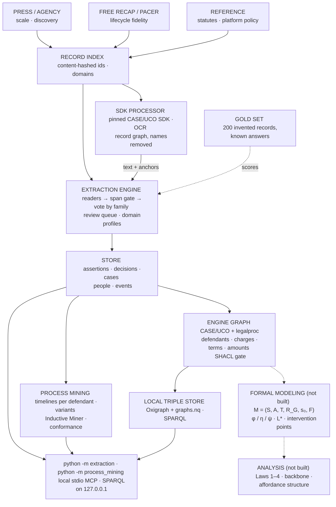

# CaseNoesis

**CaseNoesis** aggregates, structures, and decomposes case data across offense types, modeling exploitation as state machines and Markov decision processes to understand how platform affordances are misused, how crime types evolve alongside technology, and where intervention is possible.

## Origin & Framework

The theoretical foundation for this project is **["Affordances for Harm: How Offenders Misuse Platform Capabilities to Exploit Children, and Where to Intervene"](https://doi.org/10.5281/zenodo.21347781)**

AfH develops a formal affordance–misuse–harm framework (φ/η/ψ mapping) and validates it against a corpus of ICAC enforcement cases. CaseNoesis is the empirical test of whether that framework generalizes across offense types beyond the one it was originally derived from.

## Scope

- Multi-offense ingestion (fraud, trafficking, cyber-enabled crime, ICAC/CSEA)
- **Local-machine** collector (`collector/`) plus local stdio MCP to orchestrate it (`casenoesis_mcp`)
- Website/docs may run on Railway. There is **no public MCP**. CaseLinker remains the public ICAC collector and query API.
- Local FastAPI + sqlite for the researcher site and corpus tools (`python3 run/main.py`)

## Status

45,877 distinct public records are collected (46,619 rows in the lookup under `data/collected/public/`, before repeated addresses and identical files are removed). The extraction engine has read all of them: 3,133,602 span-anchored assertions, 992,716 settled values, 59,881 mentions left for a person. Defendants are linked across the records of a case, and each term and amount is placed with its defendant. What happened in each case is ordered into a dated timeline: 108,771 events in 44,156 cases. Process mining over those timelines finds the paths prosecutions take and flags cases that depart from procedural order. All 864 court filings and 68 reference records, and a 300-record press sample, also have a CASE/UCO record graph from the pinned SDK with names removed. The engine writes its own graph per record, with defendants, charges, terms, and amounts, validated against the same SDK.

Accuracy is measured on a gold set of 200 invented records written from known answers ([`gold/`](gold/)). On its held-out half the engine scores F1 of 0.98 to 1.00 on terms, amounts, dates, citations, dockets and defendants, and 0.85 to 0.94 on victim counts and scheme and channel labels.

Not done: no sample of collected records has been checked by hand, so there is no accuracy figure on real records. State machines for the new offense types are not built. No public data release yet.

## Architecture

Public enforcement records become span-anchored values, then validated knowledge graphs, then (not yet) state machines. Full design: [`Architecture design.md`](Architecture%20design.md).

**Three collection paths.** Press for scale. Free RECAP for court filings; PACER only with a spend cap. Reference records for platform rules, statutes, and calibration. They meet at processing. See [Collection](#collection).

**How a value gets stored.** Each reader writes its own assertion with a character span. One gate checks the span and re-reads the value from the text. Readers vote by evidence family: two families that agree settle a value, two that disagree veto it, and the rest goes to a review queue. The core knows fields and votes; fraud, trafficking, forced labor, cyber, and CSEA are vocabulary files. Code: [`extraction/`](extraction/).

**People, events, paths.** Readers also vote on whose each term and amount is and on what each record says happened. Defendants are linked across a case's records, events are dated and ordered per defendant, and [`process_mining/`](process_mining/) mines the common paths and checks each case against procedural order. Code: [`extraction/people.py`](extraction/people.py), [`extraction/events.py`](extraction/events.py).

**No names.** Source text stays on the machine. Assertions, graphs, and tool output carry no person's name. A defendant is `Defendant 1` with a role, linked to charges and terms.

**All local.** Clone, set up, run. The store is a SQLite file, the graphs load into a local Oxigraph store and one N-Quads file, and the MCP server and SPARQL endpoint run on this machine. Nothing here needs a hosted database.

**Graphs.** CASE/UCO with the SDK's legal-process extension, built and validated with the SDK pinned in this repo. SHACL is a publish gate, and inferred analytics are never typed as observed facts. The SDK path by itself: [`docs/sdk-encoding.md`](docs/sdk-encoding.md).

**What the system is for.** The primary purpose is to build formal models, specifically the *Exploitation State Machine*. Analysis tests Theorem 1 and Laws 1–4 across domains, annotates affordances, and *ranks intervention points*. The local website and stdio MCP expose machines and collection tools to the researcher — not to the public internet. CaseLinker remains the public ICAC collector and query API.

## Collection

Collection tools live under [`collector/`](collector/README.md). The pipeline is the same whether you run those scripts on the CLI or an agent calls them through local MCP ([`casenoesis_mcp/`](casenoesis_mcp/README.md), stdio only). Outputs land in [`data/collected/`](data/collected/README.md) and do not auto-ingest.

Press, free court records, and reference records are the three paths. A new topic is a profile, not a new pipeline. The public index is `data/collected/public/*_lookup.jsonl`: one row per record, no article text, no PDF path. Article text and PDFs stay on the machine. To fetch those rows again: `python3 -m collector.reproduce`.

Court filings enrich a press case. Search is CourtListener. Download is a filing already in free RECAP. PACER is the paid backup under [`collector/pacer/`](collector/pacer/), and only with a spend cap. State open-records requests (FOIA, Georgia, Florida) are opt-in and are not scrapers.

Local MCP is stdio only (`python -m casenoesis_mcp.server`). It is not on Railway. Tool catalog: [`casenoesis_mcp/tool_registry.md`](casenoesis_mcp/tool_registry.md). Corpus tools need `python3 run/main.py`. Collector tools do not.

## Data & Ethics

Case data is drawn exclusively from publicly available enforcement records (press releases, court filings already in the public domain) and from open-records releases obtained through lawful request. CaseNoesis public-record collection is completed in accordance with **[UMass HRPO NHSR #8252](docs/ethics/NHSR_8252.md)** (16 Sep 2026). 

## Contributing

Contributors can help by:
- Proposing offense categories and taxonomy structure
- Ingestion pipeline design for new offense categories
- Code implementation

---

*CaseNoesis builds on ideas developed in [CaseLinker](https://github.com/mrinaalr/CaseLinker), a CSEA-focused case analysis platform. The extraction engine keeps CaseLinker's design (one assertion per reader, a span gate, a vote by evidence family) and makes it domain-general. What was carried over and what was not: [`Architecture design.md`](Architecture%20design.md), section 15.*